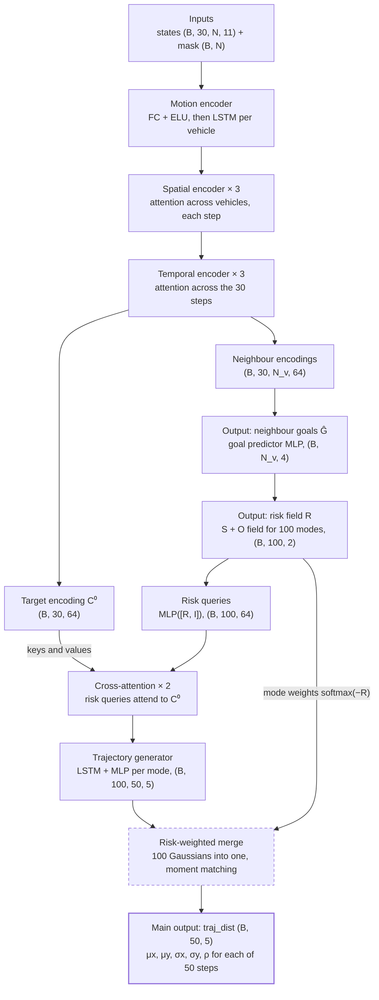

# STRAP: Paper vs Implementation — Inputs, Features, Outputs & Assumptions

As of 2026-10-19 · Prabhat Kumar Sahu

## Purpose and sources

Our reproduction follows the STRAP paper wherever it is specific. The paper is specific about the architecture, the risk equations, the loss and the hyperparameters. It is thin on how inputs are encoded and silent on several decoder details, and every gap was filled by an assumption listed here.

**Sources compared**

- Paper: Ning, Bian, Zuo, Ergan, *STRAP: Spatial-Temporal Risk-Attentive Vehicle Trajectory Prediction for Autonomous Driving*, arXiv:2507.08563v2 (14 Jul 2025). Sections used: I (motivation), III-A to III-F (method), IV-A to IV-C (setup, results, ablation).
- Code (branch `refactor/simplify`): `src/config.py`, `src/data/loader.py`, `src/risk.py`, `src/intentions.py`, `src/models/*.py`, `src/losses.py`, `src/train.py`, `src/evaluation/*.py`.

**Status labels used in every table**

| Label | Meaning |
| --- | --- |
| Matches | The code does what the paper states. |
| Paper silent | The paper gives no value or method; the code makes its own choice. |
| Deviates | The code differs from what the paper states. |
| Extension | Not in the paper; added for the MTP collision-risk objective. |

## 1. Data, windowing and splits

We use the paper's 3 s history, 5 s horizon and 0.7/0.1/0.2 ratios, on NGSIM only. The paper does not say how windows overlap or how the split is drawn, so both are our choices. Those two choices change the sample count and what the test set contains.

| Item | Paper says | We implement | Status | Assumption and reasoning |
| --- | --- | --- | --- | --- |
| Datasets | NGSIM and HighD (§IV-A) | NGSIM only: `us-101` + `i-80` from the Socrata API (`NGSIM_LOCATIONS`); `--debug` uses a us-101 subset | Deviates | HighD needs a licence and is not wired in. Lankershim and Peachtree are arterials, not freeways, so they were left out. |
| Units | Not stated | Feet converted to metres on load (`_FT_TO_M = 0.3048`) for positions, length, width, speed, acceleration | Paper silent | Risk parameters and RMSE are in metres in the paper, so metres is the only consistent choice. |
| Coordinate axes | Δx longitudinal, Δy lateral (Eq. 1) | x = NGSIM `local_y` (along the road), y = NGSIM `local_x` (across lanes) | Matches | NGSIM names its axes the other way round, so they are swapped on load. |
| Sampling rate | Not stated | 10 Hz, `DT = 0.1` s | Paper silent | NGSIM's native rate; no resampling. |
| Window | 8 s: first 3 s history, next 5 s future (§IV-A) | 80 frames = 30 history (`TH_STEPS`) + 50 future (`TF_STEPS`) | Matches | — |
| Window overlap | "segment the data into 8-second intervals"; no stride given | Sliding window, stride 10 frames (1 s) per target vehicle | Paper silent | A 1 s stride keeps the sample count manageable. The paper's 7.7M NGSIM trajectories suggests a much denser stride, so we have fewer samples than the paper. |
| Gaps in a window | Not stated | A window is skipped unless the target has 80 consecutive frame ids | Paper silent | Avoids interpolating over missing frames. |
| Which vehicles are targets | "Each vehicle in a scene is treated as a target vehicle" (§IV-A) | Every vehicle with ≥ 80 frames, at every stride position | Matches | — |
| Split ratios | 0.7 / 0.1 / 0.2 (§IV-A) | 0.7 / 0.1 / 0.2 (`TRAIN_RATIO`, `VAL_RATIO`, `TEST_RATIO`) | Matches | — |
| Split method | Not stated | Temporal: cut the frame timeline at 70% and 80%, then drop windows within one window length (80 frames) of each cut (`get_splits`) | Paper silent | A random split would put overlapping windows of the same vehicle in train and test, which leaks the answer. |
| Multi-location timeline | Not stated | `i-80` frame ids are offset to start after `us-101`'s last frame (`fetch_ngsim_multi`) | Paper silent | Makes one monotonic timeline so the temporal split works. Side effect: the test split is the end of the combined timeline, so validation and test come entirely from I-80 (measured below). |
| Sample filtering | Not stated | A sample is dropped if any target history position, target future position or valid neighbour goal is not finite (`build_samples`) | Paper silent | NaN would poison the loss. |

**Measured on the cached data** (`data/raw/ngsim/`, full download):

| Location | Rows | Unique frame ids | Vehicle ids | Rows sharing a (vehicle id, frame id) with another row | Frames holding rows from > 1 recording time |
| --- | --- | --- | --- | --- | --- |
| us-101 | 4,802,933 | 9,996 | 2,847 | 1,188,529 | 9,945 of 9,996 |
| i-80 | 4,566,387 | 11,688 | 3,001 | 405,708 | 10,011 of 11,688 |

- **Split consequence.** The combined timeline has 21,684 frames. The 70% cut falls at frame 15,178, inside I-80. Train = all of US-101 plus the first part of I-80. Validation and test = I-80 only. Test RMSE is therefore an I-80 number, not an NGSIM-wide number like the paper's.
- **Recording-period collision (high risk).** Each NGSIM location has three 15-minute recordings. They reuse the same `frame_id` and `vehicle_id` values, which the `global_time` column tells apart (up to 3 distinct times per frame id). The loader keys only on `vehicle_id` and `frame_id`. So one scene can mix vehicles that were on the road at different times. The selected neighbours then include "phantom" vehicles, and the collision ground truth can count phantom near-misses. Fix: build the time key from `global_time`, or add a period id to both keys.

## 2. Neighbour selection (who counts as N_v)

We use the paper's rule: a vehicle is a neighbour if its S-field or O-field risk is above 0.005, with at most 15 kept. The paper does not say when risk is measured, how vehicles are ranked, or what happens when nobody qualifies. We filled those gaps, and one of our fills goes against the paper.

**Paper's reasoning (§III-A):** "Instead of selecting nearby vehicles purely based on distance, we calculate the potential risk between the target vehicle and all other vehicles … and prioritize those associated with higher risk. This risk-aware selection strategy enables the model to focus on safety-critical interactions." The ablation backs this up: removing the spatial encoder, which models these interactions, raises average RMSE by 14.6% (Table III).

| Item | Paper says | We implement (`build_scenes`, `loader.py:651-689`) | Status | Assumption and reasoning |
| --- | --- | --- | --- | --- |
| Criterion | S-field risk > 0.005 or O-field risk > 0.005 (§IV-A) | `(risk_s > RISK_THRESHOLD) \| (risk_o > RISK_THRESHOLD)`, threshold 0.005 | Matches | — |
| Maximum count | N_v = 15; 6 on average (§IV-A) | `N_V = 15`, cut after ranking | Matches | We have not measured our average. Compare it with the paper's 6 as a sanity check. |
| Ranking | "prioritize those associated with higher risk" | Sort by S + O, highest first | Paper silent | The paper does not say which of the two risks drives priority, so we add them. That is the same sum the loss uses (Eq. 13). |
| When risk is measured | Not stated | Once, at the last observed frame (frame 30 of the window) | Paper silent | The last observed frame is the freshest state before prediction. The variable is called `midpoint_frame` in code, but it is the last history frame. |
| Velocity used for O-field | Not stated | Longitudinal speed difference only; lateral relative velocity = 0 | Paper silent (forced by data) | NGSIM's `v_vel` is a scalar speed along the lane. |
| Time clamp | Not stated | No clamp at selection (t can be 0); the input feature clamps t ≥ 0.1 s | Paper silent | Inconsistent between the two places. With t = 0 the O-field is slightly larger at selection than in the feature. |
| Presence requirement | Not stated | A candidate must be present in all 30 history frames | Paper silent | Keeps history free of gaps, so no imputation is needed. A neighbour may leave during the future; its goal is then masked out of the goal loss (§8). |
| Nobody above threshold | Not stated (implies 0 neighbours) | Fall back to the 15 nearest by Euclidean distance | Deviates | Avoids samples with no neighbours, which the attention and goal loss handle badly. But it lets in vehicles the paper's rule would reject. Consider dropping the fallback, or logging how often it fires. |
| Order in the tensor | Not stated | Index 0 = target, then neighbours by descending risk | Paper silent | The order matters only for padding. Attention ignores order across vehicles. |

## 3. Base state features (9 per vehicle per timestep)

The paper lists the feature groups but gives no reason for any of them, and no encoding. Its only sentence is: "Each state sᵢₜ includes the 2D coordinates relative to the target vehicle, velocity, acceleration, vehicle dimensions, types, and lane ID at timestep t" (§III-A). §IV-A adds that NGSIM and HighD provide exactly these fields. So the paper's implicit reason is "what the dataset records". Every reason in the last column below is ours, not the paper's.

All features are built in `create_sample` (`loader.py:356-385`) and then z-scored with train-only statistics (§5).

| # | Feature | Paper says | We implement | Status | Our reasoning and caveats |
| --- | --- | --- | --- | --- | --- |
| 0 | Relative x (longitudinal) | "2D coordinates relative to the target vehicle" | `local_y(v, t) − local_y(target, t)`, metres, not divided | Paper silent on reference point | Relative coordinates make the model independent of where on the road it is (translation invariance). We subtract the target's position **at the same timestep**, so the target row is always 0. The target's own path history is visible only through speed and acceleration. A fixed origin (last observed position) would keep that path. |
| 1 | Relative y (lateral) | same | `local_x(v, t) − local_x(target, t)`, metres | Paper silent on reference point | Same as #0. Because the target row is always 0, a lane change in progress is invisible for the target except through its lane id. |
| 2 | Velocity x | "velocity" | NGSIM `v_vel` ÷ 30; absolute speed, not relative | Paper silent on frame and form | Speed is the strongest short-term predictor (the constant-velocity baseline gets 3.15 m average RMSE, Table I). ÷30 ≈ freeway top speed in m/s. |
| 3 | Velocity y | "velocity" | Always 0 | Deviates (forced by data) | NGSIM has no lateral velocity column. This feature carries no information. After z-scoring its std clamps to 1e-6 and it stays 0. It could be derived from Δ`local_x` / Δt if lateral speed is wanted. |
| 4 | Acceleration | "acceleration" | NGSIM `v_acc` ÷ 10; longitudinal only | Matches | Shows braking or speeding up before position changes. ÷10 ≈ a maximum acceleration in m/s². |
| 5 | Vehicle type | "types" | NGSIM `v_class` ÷ 2 (1 motorcycle, 2 car, 3 truck); value from the window's first row; one number, not one-hot | Paper silent on encoding | Trucks and motorcycles behave differently. Treating the class as a number implies an order (truck = 1.5 × car). The data is about 97% cars (us-101: 4.68M of 4.80M rows). |
| 6 | Lane id | "lane ID" | NGSIM `lane_id` per timestep ÷ 2; absolute lane number | Paper silent on encoding | The lane limits lateral moves, and lane id changes record lane changes. Absolute ids differ by site: us-101 has lanes 1–8, i-80 has 1–7, and the higher numbers include ramp or auxiliary lanes. The lane relative to the target's lane (−1 / 0 / +1) would generalise better. |
| 7 | Length | "vehicle dimensions" | NGSIM `v_length` ÷ 10, metres, from the window's first row | Paper silent on scaling | Positions are vehicle centres, so size sets the real clearance. |
| 8 | Width | "vehicle dimensions" | NGSIM `v_width` ÷ 3, metres | Paper silent on scaling | Same as #7. |

**The hand divisors have no effect.** Every feature is z-scored afterwards: (x/c − mean(x/c)) / std(x/c) = (x − mean) / std. Dividing by 30, 10, 2 or 3 changes nothing the model sees. They only matter if z-scoring is removed.

## 4. Risk input features (features 9 and 10)

The risk features are the best-justified inputs in the paper, and our equations match it exactly. The parameter values are not given, though, and our placeholder S-field scale makes feature 9 nearly always zero.

**Paper's reasoning**

- Motivation (§I): "human drivers subconsciously evaluate potential dangers by considering the proximity, velocity, and motion directions of surrounding vehicles" [3]. A model should see the same cues.
- Why a field and not TTC (§I): TTC-style measures are "point-based and static, unable to adequately capture the continuous and dynamic spatial-temporal interactions."
- Why both a spatial and a temporal part (§I): earlier risk fields "predominantly considered only spatial proximity, neglecting crucial temporal factors like the time remaining to a potential collision."
- Why add them to the input (§III-A): "To improve the model's risk awareness, we … augment the vehicle state inputs with additional risk features … the subjective and objective risks perceived by vehicle i."

**S-field (Eq. 1)**: perceived proximity risk. "The closer a surrounding vehicle intrudes the safety space of the target vehicle, the greater the risk" (§III-B).

$$
r^{s}_{ij} = \exp\left(-\left|\frac{\Delta x_{ij}}{\gamma_x}\right|^{\alpha_x} - \left|\frac{\Delta y_{ij}}{\gamma_y}\right|^{\alpha_y}\right), \quad \gamma_x,\gamma_y > 1,\ \alpha_x,\alpha_y \ge 2
$$

**O-field (Eq. 2)**: collision probability from the predicted closest approach, where t̂ₘ is "the time frame when the gap between the vehicles stops narrowing."

$$
r^{o}_{ij} = \exp\left[-\left(\frac{\hat d_{m,ij}}{d^{*}}\right)^{\beta_1}\right] \exp\left[-\left(\frac{\hat t_{m,ij}}{t^{*}}\right)^{\beta_2}\right]
$$

| Item | Paper says | We implement (`risk.py`, `loader.py:387-407`, `config.py`) | Status | Assumption and reasoning |
| --- | --- | --- | --- | --- |
| S-field formula | Eq. 1 | `compute_s_field`, exactly Eq. 1 | Matches | — |
| γx, γy | > 1, no value | 1.5 m, 1.5 m | Paper silent | Smallest round value meeting the constraint. **Problem:** S > 0.005 only within about 3.4 m centre to centre. A car in the next lane (about 3.7 m across) scores about 0.002. Fig. 1(b) shows the S-field visibly non-zero over roughly ±15–20 m along the road and ±2 m across it (read off the plot, approximate), which implies γx in the tens of metres. |
| αx, αy | ≥ 2, no value | 2, 2 | Paper silent | Smallest allowed value, which makes the field Gaussian. |
| O-field formula | Eq. 2 | `compute_o_field`, exactly Eq. 2 | Matches | — |
| d̂ₘ, t̂ₘ | "predicted future minimum distance" and when the gap stops narrowing; method not given | Constant relative velocity closest approach: t = −(p·v)/\|v\|² clamped ≥ 0, d = \|p + t·v\| (`closest_approach`) | Paper silent | The simplest prediction that fits the definition. A vehicle moving away gets t = 0 and d = current gap. Reference [21] uses multi-modal predicted trajectories instead. |
| d*, t*, β1, β2 | No values | d* = 5 m, t* = 2 s, β1 = β2 = 1 | Paper silent | Plausible freeway scales; labelled "reproduction assumption" in `config.py`. |
| Time clamp | Not stated | t̂ₘ clamped to ≥ 0.1 s in the feature | Paper silent | Avoids a vehicle moving away getting the maximum time factor of 1. |
| Relative velocity | Not stated | Longitudinal speed difference only (lateral = 0) | Forced by data | Same NGSIM limitation as feature 3. |
| Whose risk is rᵢ | "the subjective and objective risks perceived by vehicle i" | Pairwise risk between the target and vehicle i; target row set to 0 | Paper ambiguous | Another reading is each vehicle's total risk from all others (Σⱼ rᵢⱼ). We chose target-centric because the whole model is target-centric. |
| Timing | Per history timestep (R over T−Tₕ:T) | Computed at all 30 history steps | Matches | — |
| Source model | "We adopt the safety potential field model … from [21]" (Wang et al. 2022) | Eq. 1–2 as printed | — | The subjective/objective naming matches [22] (Zuo et al. 2025, *Composite Safety Potential Field*, shared co-authors). That paper is the likeliest place to find the real parameter values. |

## 5. Input tensor, mask, padding and normalisation

The model takes two tensors: `states` of shape (B, 30, N, 11) and `mask` of shape (B, N), with N ≤ 16. The paper defines only the state sequence S ∈ Tₕ × (Nᵥ+1). It says nothing about masks, padding or normalisation, so this whole section is our design.

| Item | Paper says | We implement | Status | Assumption and reasoning |
| --- | --- | --- | --- | --- |
| State tensor | S over Tₕ timesteps for target (i = 0) and Nᵥ neighbours (§III-A) | `states`: (B, Tₕ = 30, N, F = 11); index 0 = target | Matches | — |
| Feature count | Not stated | `STATE_DIM = 11` = 9 base + 2 risk | Matches the listed groups | — |
| Padding | Not stated | `collate_fn` pads each batch to its own largest N (not always 16) with zeros | Paper silent | Scenes have different neighbour counts. Padding per batch saves memory. |
| Mask | Not stated | `mask` (B, N) bool, True = real vehicle | Paper silent | Lets padding be ignored. |
| Where the mask is used | — | Spatial attention: `key_padding_mask = ~mask`, so padding is never attended to. Temporal encoder: padded outputs multiplied by 0. Decoder: padded neighbours' S and O risk set to 0. Goal loss: separate `goal_mask` | Paper silent | The motion LSTM and temporal attention still run on padded rows, but their outputs are zeroed or masked before they reach the target. |
| Normalisation | Not stated | Per-feature z-score; mean and std from the **training split only**, over every (timestep, vehicle) entry, NaN ignored, std floored at 1e-6; saved to `normalization.json`; reused for val, test and collisions | Paper silent | Standard practice. Train-only statistics stop test data from leaking into training. |
| NaN handling | Not stated | After z-scoring, any NaN or ±inf becomes 0 (the feature mean) | Paper silent | Neighbours already have full histories (§2), so this mostly catches NaN in static fields. |
| Labels | Not stated | Not normalised: metres relative to the target's last observed position | Paper silent | Keeps loss and RMSE in metres, as the paper reports. |
| Side effect | — | Target rows (features 0–1 = 0, risk = 0) are included in the statistics | — | This drags the means of features 0, 1, 9 and 10 toward 0. It is harmless but worth knowing. |

## 6. How the inputs travel through the model

The module order and hyperparameters match the paper. Two structural choices may not: how the encoder layers are stacked, and whether the intention modes stay fixed. The rest of the differences are small details the paper leaves open.

The target's encoding and the neighbours' encodings split after the temporal encoder. The neighbour side becomes risk queries, which then read the target's history through cross-attention. The dashed box is our design; the paper does not specify it. Paper Fig. 2 suggests interleaving the encoders (S, T, S, T, S, T); we run 3 S, then 3 T.

| Stage | Paper says | We implement | Status | Assumption and reasoning |
| --- | --- | --- | --- | --- |
| Motion encoder | FC + ELU, then LSTM (§III-D) | `Linear(11→64)` + ELU, then a 1-layer LSTM over 30 steps per vehicle, **plus a LayerNorm** | Matches + addition | The LayerNorm stabilises the scale going into attention. |
| Spatial encoder | MHA across vehicles, then LayerNorm(GLU(H̃) + H̃) (Eq. 3–4) | Per timestep: 4-head MHA across vehicles with the padding mask; `Linear(64→128)` then GLU, residual, LayerNorm | Matches | GLU halves the width, so a 2D projection is needed; the paper omits it. Eq. 4 prints H̃ₜ, a typo for H̃ₛ. |
| Temporal encoder | Add sinusoidal PE, MHA across time, GLU, LayerNorm (Eq. 5–7) | Per vehicle: PE added, 4-head MHA over 30 steps (no causal mask), padded rows zeroed, then GLU, residual, LayerNorm | Matches | Non-causal is fine: all history is known at prediction time. |
| Layer stacking | "The spatial and temporal encoder layers can be stacked N times"; Fig. 2 draws one ×N box around both | 3 spatial layers, **then** 3 temporal layers (`strap.py:85-93`) | Probably deviates | Fig. 2 suggests interleaving (S, T, S, T, S, T). Ours does all spatial first, then all temporal. Worth switching to match the figure. |
| Heads, dropout | Not stated | 4 heads, dropout 0.1 | Paper silent | Common defaults for D = 64. |
| Goal predictor | Flatten Tₕ × D per neighbour, then MLP → 4 (Eq. 8) | Flatten 30 × 64 = 1920, then MLP 1920→128→128→4 with ReLU and dropout | Matches | Hidden size 128 is our choice. |
| Intention modes | K = 100 k-means centres of training GT endpoints (§III-E) | k-means on training endpoints (`intentions.py`), loaded into `intention_means`, **an `nn.Parameter` the optimiser keeps updating** | Deviates | The paper treats modes as fixed cluster centres. Ours drift during training. Register them as a buffer to freeze them. |
| Risk per mode | Rₛ = Σⱼ rˢ₀ⱼ, Rₒ = Σⱼ rᵒ₀ⱼ between each mode's endpoint and predicted neighbour goals | Same sums; relative position and velocity at the endpoint, O-field from constant velocity onward, t ≥ 0.1 s, padded neighbours masked | Matches | How the O-field is computed at an endpoint is ours (§4). |
| Risk queries | H⁰_q = MLP([R, I]) (Eq. 9) | `Linear(6→64)`, ReLU, dropout, `Linear(64→64)`, ReLU | Matches | — |
| Cross-attention | M layers, q = H_q, k = v = C⁰ (Eq. 10); M = 2 | 2 layers; q = H_q, **k = Linear(C⁰)**, v = C⁰; LayerNorm after each; no residual | Matches + additions | The key projection and LayerNorm are ours. The paper prints C⁰ ∈ ℝ^(T_f × D), a typo: the encoder only covers Tₕ. |
| Trajectory generator | "an LSTM followed by an MLP" producing Ŷ ∈ ℝ^(T_f × 5) | Each mode's query repeated 50 times as LSTM input, then MLP to 5 values per step, giving K separate 50-step Gaussians | Paper silent on how a query becomes a sequence | Repeating the query is the simplest way to drive an LSTM from one vector. |
| K modes to one output | Not stated | Weights = softmax(−(Rₛ + Rₒ)) over modes; mean, variance and covariance matched into one Gaussian per step (`risk_decoder.py:179-202`) | Paper silent | The paper's Y has one Gaussian per step, so the modes must be merged. Fig. 3 says "Multi-modal Trajectory Prediction", which hints the authors may output several. Our weights favour lower-risk modes and are not learned. |
| Training | Adam, lr 5e-4 × 0.6 per epoch, batch 128, 12 epochs | Same, plus weight decay 1e-5 and gradient clipping at norm 1.0; best checkpoint chosen by validation loss | Matches + additions | Clipping guards against blow-ups from the exponential risk factor in the loss. |

## 7. Outputs

The main prediction is `traj_dist[..., :2]`: the target's 50 future positions (5 s at 10 Hz), in metres from its last observed position. The other two outputs are intermediate. They exist so the decoder can reason about future risk, and the loss trains them too.

| Output | Shape | Paper says | We implement | Status | Assumption and reasoning |
| --- | --- | --- | --- | --- | --- |
| **Target trajectory distribution** | (B, 50, 5) | A bivariate Gaussian per future step: μ̂ = (μ̂x, μ̂y), σ̂ = (σ̂x, σ̂y), ρ̂ (§III-A, following STDAN [12]). Reason: "To address the variability and uncertainty in vehicle movements, we apply distribution learning"; the output "is de-facto a probability density function capturing the likelihood of various potential positions." | [μx, μy, σx, σy, ρ]; per mode σ = softplus + 1e-6 and ρ = tanh, then merged across modes (§6); final ρ clamped to ±0.999 | Matches in form | The reference frame is ours: the origin is the target's last observed position, x along the road, y across it. The paper does not state the output frame. |
| Neighbour goals Ĝ | (B, Nᵥ, 4) | Final position and velocity of each neighbour at the end of the horizon (Eq. 8). Reason: the design "is inspired by goal-based trajectory prediction" (TNT [18], Gan et al. [19]). The decoder needs neighbours' future positions to score future risk for each target intention. | [x, y, vx, vy] at t = T + 5 s; x, y relative to the target's last observed position | Matches | Ground-truth vy is always 0 (NGSIM), so the model learns vy ≈ 0. Neighbours that leave the scene before 5 s have no ground truth and are masked. |
| Risk field R | (B, 100, 2) | "By computing the risk values R = (Rₛ, Rₒ) for all K intention modes and concatenating them with … I, a discrete spatial field of future potential risk distribution is obtained" (§III-E). Ablation: removing risk fusion raises RMSE by 3.4% (Table III). | (Rₛ, Rₒ) per mode, summed over real neighbours | Matches | Also feeds the risk-scaled loss and the mode weights (§8, §6). |
| Intention codebook I | (100, 4), fitted once | "k-means clustering on the final positions of the ground-truth (GT) trajectories to derive K different intention modes, I ∈ ℝ^(K×4)", each "characterized by its longitudinal and lateral position as well as velocity at the final predicted timestep" (§III-E) | k-means (sklearn, seed 42, 10 inits) on 4-D [x₅ₛ, y₅ₛ, vx, vy] of training targets only | Paper inconsistent | The paper says "final positions" but I is 4-D, so we cluster on position and velocity. Velocity is a proxy, (p[49] − p[40]) / 1.0 s, which spans 0.9 s and so understates speed by about 10%. Its vy is non-zero, unlike the neighbours' vy = 0. |

## 8. Labels, loss and evaluation

The loss terms match Eq. 11–14 in form. The risk-scaling factor γ_risk is where we interpreted most: the paper does not say which Rₛ and Rₒ feed it. Ours lets gradients flow through γ_risk, which gives the model a way to cheat.

**Paper's reasoning for the risk-scaled loss (§III-F):** "for the same MSE or NLL value, a higher risk level results in a larger total loss. By assigning greater weight to such cases, the model is encouraged to learn more discriminative features in situations where the consequences of prediction errors are potentially severe." Evidence: STRAP-R and STRAP-B have the same overall RMSE (1.78 m, Table I). STRAP-R is better in high-risk scenes, e.g. 3.53 vs 3.61 m for "collision in 1 s" (Table II).

$$
\gamma_{risk} = \max\left[\exp(R^{s}+R^{o}) - \beta,\ 1\right], \qquad \mathcal{L}_{total} = \gamma_{risk}\left(\mathcal{L}_{goal} + \mathcal{L}_{traj}\right)
$$

| Item | Paper says | We implement | Status | Assumption and reasoning |
| --- | --- | --- | --- | --- |
| Trajectory ground truth | μ^gt_t, "the ground truth coordinate of vehicle i at time t" | Target positions at steps 31–80 minus its position at step 30, metres | Paper silent on frame | Same frame as the output (§7). |
| Goal ground truth | Ground-truth endpoints G | Neighbour [x, y] at step 80 minus the target origin, plus [v_vel, 0]; masked if the neighbour is missing at step 80 | Matches | — |
| L_goal | \|\|Ĝ − G\|\|², MSE (Eq. 11) | Squared error averaged over valid neighbours **and the 4 components** (`goal_loss`) | Matches (scale differs) | Averaging over 4 components makes it 1/4 of a summed norm. Metres and m/s are mixed unweighted. |
| L_traj | (1/T_f) Σ [\|\|μ̂ − μ\|\|² − log N(μ \| μ̂, σ̂, ρ̂)] (Eq. 12) | Squared error summed over x, y and averaged over 50 steps, plus bivariate Gaussian NLL averaged over 50 steps | Matches | — |
| Which R in γ_risk | "the sum of the subjective and objective risks Rₛ and Rₒ perceived by the target vehicle" | The decoder's predicted future risk, averaged over the 100 modes: meanₖ(Rₛ,ₖ + Rₒ,ₖ) | Paper ambiguous | It could instead mean observed risk at time T, or risk from ground-truth futures. Ours uses predicted risk, which needs no extra data at training time. |
| γ formula | max[exp(R) − β, 1] | clamp(exp(min(R − β, 88.7)), 1, 1e4) | Deviates when β ≠ 0 | exp(R − β) is not exp(R) − β. They are equal only at β = 0, the current setting. The 88.7 and 1e4 caps prevent float32 overflow. |
| β | "a pre-defined bias term", no value | `BETA_LOSS = 0.0` | Paper silent | Neutral default. |
| Gradient through γ | Not stated | **Not detached.** γ depends on predicted goals and on the trainable codebook | Risk | The model can lower its loss by predicting neighbour goals or modes that look less risky, rather than more accurate ones. Detach γ, or compute R from observed inputs. |
| Validation loss | Not stated | Risk input set to 0, so γ = 1; best checkpoint chosen on this unscaled loss | Paper silent | Picks the checkpoint on accuracy alone. |
| STRAP-B | L_goal + L_traj | `--basic_loss` | Matches | — |
| Metric | RMSE (m) at 1–5 s, plus an average (Table I) | sqrt(mean squared displacement) at steps 10, 20, 30, 40, 50; average = mean of the five | Matches | The paper does not define RMSE. Ours follows CS-LSTM [10], and the paper's Average column fits it: STRAP-R (0.37 + 0.94 + 1.61 + 2.47 + 3.52) / 5 = 1.78. |
| Risk-level breakdown | Table II: RMSE for "Collision in 1 s / 2 s / 3 s / 5 s" and non-collision scenes | Not implemented | Gap | The paper does not define how a scene is labelled "collision in N s". |
| Collision evaluation | Not in paper | `--mode collisions`: predicted target μ versus neighbours rolled out at constant velocity from step 30; 11 risk metrics; label = ground-truth minimum centre-to-centre distance over 5 s < 2.0 m | Extension | Serves the MTP pairwise collision-risk goal. Caveats: vehicle size is ignored, neighbours move at constant velocity, and phantom vehicles from other recording periods (§1) can create false collisions. |

## 9. Assumption register

We made 25 assumptions or choices that are not in the paper. Five are high impact: they can change results or how they should be read. Impact is our estimate.

| # | Assumption or choice | Where in code | Why we made it | Impact |
| --- | --- | --- | --- | --- |
| 1 | Scenes are keyed on `vehicle_id` + `frame_id` only, so NGSIM's three recording periods per site are overlaid | `loader.py` `build_scenes` | Not noticed; ids look unique | High |
| 2 | γ_risk is not detached from the graph | `losses.py` `risk_scaled_loss` | Not considered | High |
| 3 | The intention codebook is a trainable `nn.Parameter` | `risk_decoder.py` `intention_means` | Convenient way to load centres | High |
| 4 | S-field γx = γy = 1.5 m | `config.py` | Smallest round value meeting γ > 1 | High |
| 5 | Temporal split over a us-101 → i-80 timeline, so val and test are I-80 only | `loader.py` `get_splits`, `fetch_ngsim_multi` | Avoid leakage from overlapping windows | High |
| 6 | Encoder stacking: 3 spatial, then 3 temporal | `strap.py:85-93` | Read "stacked N times" as two stacks | Medium |
| 7 | Positions relative to the target at each timestep (target row = 0) | `loader.py:354` | Paper: "relative to the target vehicle" | Medium |
| 8 | Lateral velocity = 0 everywhere | `loader.py` `build_scenes` | NGSIM gives scalar speed only | Medium |
| 9 | 100 modes merged into one Gaussian with risk-softmax weights and moment matching | `risk_decoder.py:179-202` | Paper's output is one Gaussian per step; merge method not given | Medium |
| 10 | γ_risk uses predicted future risk averaged over modes | `losses.py` | Paper ambiguous about which R | Medium |
| 11 | Fall back to the 15 nearest vehicles when none pass the 0.005 threshold | `loader.py:678-684` | Avoid empty scenes | Medium |
| 12 | Sliding-window stride of 1 s | `NGSIMDataLoader(stride=10)` | Compute budget | Medium |
| 13 | NGSIM us-101 + i-80 only; no HighD | `config.py` `NGSIM_LOCATIONS` | Data access; freeway scope | Medium |
| 14 | d* = 5 m, t* = 2 s, β1 = β2 = 1 | `config.py` | Plausible freeway scales | Medium |
| 15 | d̂ₘ, t̂ₘ from constant-relative-velocity closest approach | `risk.py` `closest_approach` | Simplest model that fits the definition | Medium |
| 16 | Neighbours must be present in all 30 history frames | `loader.py` `build_scenes` | No imputation needed | Low |
| 17 | Selection risk measured at the last history frame, without the 0.1 s clamp | `loader.py:651-677` | Freshest state | Low |
| 18 | Vehicle type and lane encoded as single scaled numbers | `loader.py:361-378` | Simplicity | Low |
| 19 | Hand divisors (÷30, ÷10, ÷2, ÷3) before z-scoring | `loader.py:373-381` | Leftover from before z-scoring; no effect now | Low |
| 20 | Train-only per-feature z-score; NaN set to 0 | `normalization.py` | Standard; no leakage | Low |
| 21 | Codebook velocity proxy over 0.9 s divided by 1.0 s | `intentions.py` `build_codebook_from_samples` | Approximate endpoint velocity | Low |
| 22 | Extra LayerNorms, key projection, 2D projection before GLU, 4 heads, dropout 0.1, goal MLP width 128 | `models/*.py` | Paper silent; common defaults | Low |
| 23 | Weight decay 1e-5 and gradient clipping at norm 1.0 | `train.py` | Stability under exp-scaled loss | Low |
| 24 | β = 0 and the exp(R − β) form | `config.py`, `losses.py` | No value given; equal to the paper at β = 0 | Low |
| 25 | Collision label = GT centre distance < 2.0 m within 5 s; neighbours rolled out at constant velocity | `pipeline.py` `gt_min_dist`, `rollout_pairs` | MTP extension; simple first cut | Low |

## 10. Recommended fixes, in priority order

Fix the data keying first. Every other result, including the collision ground truth, sits on top of it.

- [ ] Key frames and vehicles by recording period: use `global_time`, or add a period id to `vehicle_id` and `frame_id` (register #1).
- [ ] Detach γ_risk in `risk_scaled_loss`, or compute R from observed inputs (#2).
- [ ] Freeze the intention codebook: `register_buffer` instead of `nn.Parameter` (#3).
- [ ] Re-derive γx, γy from reference [22] or from Fig. 1(b), then log the share of non-zero S-field values (#4).
- [ ] Split each location by time separately, or report test RMSE per location, so the test set covers both us-101 and i-80 (#5).
- [ ] Interleave the encoder layers (S, T, S, T, S, T) to match Fig. 2 (#6).
- [ ] Use a fixed origin (the last observed target position) for history positions, so the target's own path is visible (#7).
- [ ] Derive lateral velocity from Δ`local_x` / Δt (#8).
- [ ] Log how often the nearest-15 fallback fires, and the average neighbour count, against the paper's 6 (#11).
- [ ] Implement the Table II risk-level breakdown once "collision in N s" is defined.

**Paper typos to note in the report:** Eq. 4 uses H̃ₜ where H̃ₛ is meant. Eq. 7 gives C as (Nᵥ+1) × Tₕ × D while Eq. 3–4 use Tₕ × (Nᵥ+1) × D. Eq. 10 gives C⁰ ∈ ℝ^(T_f × D) where Tₕ is meant. §III-B cites [21] for the S/O field, but the naming matches [22].
