# Risk Over Time for One Vehicle: 15 Models, Five Encounters

Companion to [RISK_PREDICTION_RESULTS.md](RISK_PREDICTION_RESULTS.md), which covers the
risk-scoring protocol and the 30 measures, and to
[RISK_TUNING_RESULTS.md](RISK_TUNING_RESULTS.md), which covers the 15 models, tuning, and
the aggregate risk comparison. Those studies report one number per (vehicle, neighbour)
pair. This one follows a single vehicle through time. Every model is re-run every 0.1 s,
and the plots show how its predicted collision risk rises and falls as the vehicle meets
five different neighbours.

---

## Summary

- **The risk value is not standardised, and only four measures are probabilities.**
  - Nothing in the pipeline z-scores or rescales a risk score; each measure keeps its own
    unit.
  - `p_coll_gauss`, `p_coll_mc`, `p_pdrf` and `rss_ds` lie in [0, 1].
  - They are **uncalibrated**: every Brier skill score in the study is negative. They rank
    pairs well, but p = 0.2 does not mean that 20 % of such pairs collide (§1).
- **The vehicle is a motorcycle, 1102724 (US-101, 1.2 m × 0.6 m), filtering between
  lanes** in congested traffic. In under 5 s it passes within 2 m of three cars. It was
  chosen because, after bad tracks are filtered out, it carries a well-detected
  collision, a missed collision and a near miss (§3).
- **The models warn about the detected collision about 4.4 s ahead, but that lead time is
  set by the data window, not the model.**
  - All 15 models exceed p = 0.1 at the first window in which the car is among the
    motorcycle's 15 nearest vehicles (−4.4 s, 28 m away).
  - The safe neighbour scores exactly 0 for every model.
  - The missed collision stays below 0.1 for 11 of 15 models.
- **Under `cv`, 10 of 15 models score a false alarm at least as high as the real
  collision.** A car 9 m behind in the same lane, at the same speed, peaks at a median
  0.217, against 0.187 for the collision. On one vehicle, these probabilities do not
  reliably separate danger from safety.
- **Under `pred`, the two study leaders separate them.**
  - inatran and cognitive keep the false alarm at **0.006** while flagging the collision
    at 0.22 and 0.18.
  - The other 13 models flag the false alarm at up to 0.57.
  - This is the aggregate `pred` ranking of RISK_TUNING_RESULTS §5.4, seen on one
    vehicle.
- **Probabilities and mean-path measures fail in opposite ways** (§8).
  - The false alarm comes from the predicted *spread*: the predicted path stays at least
    3.3 m away, and `min_dist`, `tet` and `ttc_true` rate it safe.
  - The "missed" collision is missed only by the probabilities: the predicted path comes
    within 1.85 m.
- **The 2 m label is a surrogate.**
  - All three "collisions" are side-by-side passes: no longitudinal gap, 1.7–2.1 m apart
    laterally.
  - At that offset the vehicles' boxes never touch, so box-overlap risk peaks 1–4 s
    *before* the pass, while the predicted paths still converge (§4).
- **Added later: STGAT-EDGRU and its Collision Risk Index (§13, [STGAT_EDGRU.md](STGAT_EDGRU.md)).**
  - Under `cv` it gives the false alarm the lowest value of any model (0.022, tuned 0.003).
    Under `pred` it gives it the highest (0.727, tuned 0.796).
  - The CRI (paper and fixed versions) scores all three events above the false alarm in
    every model under `cv`, which `p_coll_gauss` does in 4 of 17. But it saturates near
    0.5 on all three events, so it cannot tell a collision from a near miss.
  - The 15-model results above are unchanged.

---

## 1. Is the risk value a probability or a standardised value?

Neither one in general.

| family | measures | output | in [0, 1]? |
|---|---|---|---|
| distance / time surrogates | `min_dist`, `ttc`, `ttc_true`, `pet`, `thw`, `tet`, `tit`, `dce`, `ttce`, `psd`, `pret`, `tmd` | metres, seconds (or m·s) | no |
| deceleration / kinematics | `drac`, `rd`, `btn`, `stn`, `a_lat_req`, `dst`, `delta_v` | m/s², m/s or a ratio | no |
| risk fields | `s_field`, `o_field`, `s_field_cal`, `o_field_cal`, `so_field_cal` | field value, unbounded | no |
| severity | `conflict_index` | joules | no |
| **collision probability** | **`p_coll_gauss`, `p_coll_mc`** | **probability** | **yes** |
| probability × severity | `p_pdrf` | probability × P(fatal) | yes |
| formal | `rss_ds` (0/1 flag), `rss_margin` (m) | flag / metres | flag only |

- **No measure is standardised.** Nothing z-scores, min-max scales or ranks the scores;
  a model's raw output feeds each formula directly. Scores from different measures are
  therefore not comparable in size. That is why the studies compare them by ROC-AUC, a
  rank statistic.
- **The probabilities are not calibrated.**
  - Across the test split, the Brier skill score of `p_coll_gauss` under `pred` is
    negative for every model: mean −3.8 baseline, −4.4 tuned (RISK_TUNING_RESULTS §5.8).
  - So a high p is a *ranking* signal, "riskier than most pairs", not a frequency.
  - Using a fixed threshold such as "warn at p > 0.1" would need a calibration step
    first (for example Platt or isotonic scaling on a validation split). This study does
    not do that.

The rest of this document uses the two collision probabilities, plus four other headline
measures in §8.

---

## 2. How one point on a curve is computed

### 2.1 The pipeline

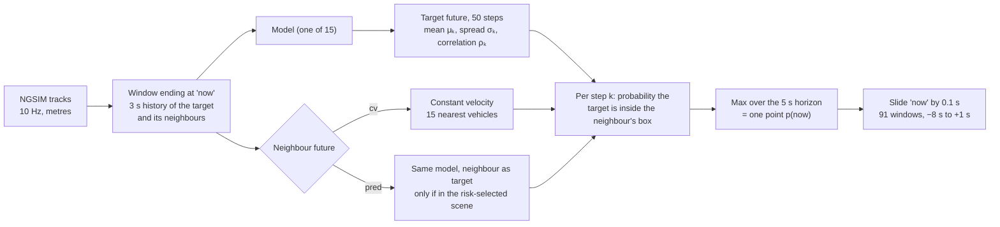

One window at a time:

```
   ◄──────── 3 s history (30 frames) ────────►│◄──────────── 5 s prediction (50 steps) ────────────►
   observed: target + neighbours              now  model: μ₁…μ₅₀, σ₁…σ₅₀       risk = max over k
```

The x-axis of every plot is "now", in seconds relative to the true closest approach
(t = 0). The y-value at x = t is the risk the model would report at time t about the next
5 s. A value at t = −3 s therefore already "sees" the encounter at t = 0, because 0 lies
inside its 5 s horizon.

### 2.2 The two probabilities

At each future step k = 1…50 (Δ = 0.1 s) the model gives the target's predicted position
μₖ and standard deviations σₖ = (σ_long, σ_lat). The neighbour is at nₖ. Let
δₖ = nₖ − μₖ, and let h = ((L₁+L₂)/2, (W₁+W₂)/2) be the summed half-lengths and
half-widths of the two vehicles.

**`p_coll_gauss`** is the worst single step of a Gaussian box integral. It is factorised
over the two axes, so it ignores ρ:

$$
P_k=\prod_{a\in\{\text{long},\,\text{lat}\}}\left[\Phi\!\left(\frac{h_a+\delta_{k,a}}{\sigma_{k,a}}\right)-\Phi\!\left(\frac{-h_a+\delta_{k,a}}{\sigma_{k,a}}\right)\right],\qquad
p_{\text{coll\_gauss}}=\max_{k} P_k
$$

**`p_coll_mc`** is the probability of overlap at *any* step, estimated by Monte Carlo.
It draws 64 samples εₛ,ₖ ~ N(0, Σₖ), using the full covariance including ρ:

$$
p_{\text{coll\_mc}}=\frac{1}{64}\sum_{s=1}^{64}\mathbf{1}\!\left[\exists k:\ |n_k-(\mu_k+\varepsilon_{s,k})|\le h\ \text{(both axes)}\right]
$$

The noise is drawn independently at each step. A sample trajectory is therefore not a
smooth path, and "any of 50 steps" compounds to roughly 1 − ∏ₖ(1 − Pₖ). That is why
`p_coll_mc` sits far above `p_coll_gauss` in §9. Its resolution is 1/64.

### 2.3 Two sources for the neighbour

| | `cv` | `pred` |
|---|---|---|
| target future | the model | the model |
| neighbour future | constant velocity from its current speed | the same model, run with the neighbour as target, shifted into the target's frame |
| which neighbours | the 15 nearest vehicles at "now" | only those in the target's *risk-selected scene* (S/O-field above threshold, at most 15) |
| defined | whenever the car is among the 15 nearest | only after the scene selects the car, often < 1 s before the pass |
| role in the studies | the recommended deployable risk (`p_coll_gauss` ROC-AUC 0.960–0.966 over the 8 baselines) | headline source; ranks the models (0.848–0.938) |

Both are plotted. `cv` gives the longer timeline; `pred` is the one the study ranking is
based on. §7 shows exactly which windows each source covers.

---

## 3. Choosing the vehicle and the five encounters

### 3.1 The procedure

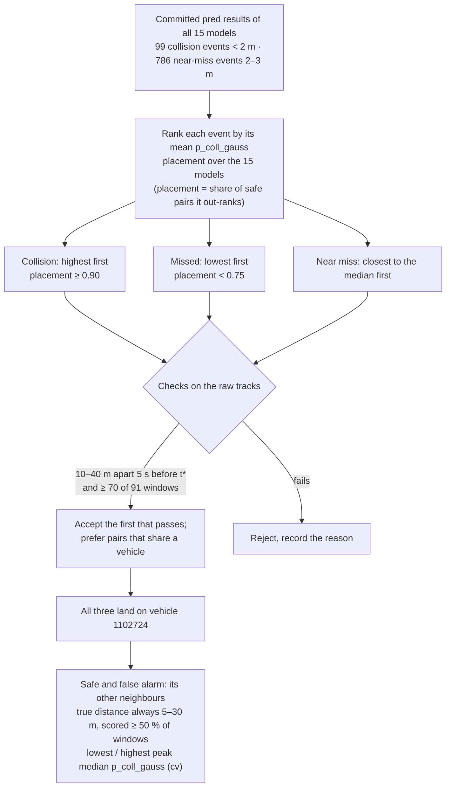

### 3.2 Why the raw ranking cannot be used as-is

The highest-ranked "collisions" are mostly not encounters at all:

| reason | collision list | missed list | what it is |
|---|---|---|---|
| no approach (< 10 m apart 5 s before) | 16 | 0 | two tracks of one car, or a car creeping alongside: the 13 top-ranked events were all 0.5–9.8 m apart 5 s before, the worst two ids 0.2 m apart for 9 s |
| implausible closing (> 40 m in 5 s) | 1 | 10 | > 8 m/s mean closing to < 2 m in the same lane; NGSIM contains no real crashes, so these are bad tracks (two vehicles recur in about 10 events each) |
| track too short (< 70 windows) | 0 | 3 | the track ends at the event, so most windows are missing |

A duplicate track scores p ≈ 1 at every window, so it tops the placement ranking while
showing nothing about prediction. Every rejected event and its reason is in
`experiments/results/risk_timeline/windows.json`.

### 3.3 The five encounters

| case | neighbour | true min distance | 5 s before | gap at t = 0: long., lat. (m) | speeds: motorcycle / other (m/s) | mean placement, 15 models |
|---|---|---|---|---|---|---|
| collision (detected) | 1102706 | 1.67 m | 31.9 m | −0.08, +1.66 | 3.9 / 1.5 | 0.909 |
| collision (missed) | 1102714 | 1.81 m | 26.9 m | −0.12, +1.81 | 13.2 / 6.3 | 0.695 |
| near miss | 1102704 | 2.10 m | 38.1 m | 0.00, −2.10 | 4.8 / 0.0 | 0.729 |
| no collision (safe) | 1102710 | 11.3 m | — | other lane, 11 m across | — | — |
| false alarm | 1102723 | 6.3 m | — | same lane, 9 m behind at t = −7 s | 10.9 / 10.7 | — |

The safe and false-alarm neighbours come from the collision case's window. Their "t = 0"
is the motorcycle's collision moment, not a closest approach of their own.

---

## 4. The vehicle and the geometry of a "collision"

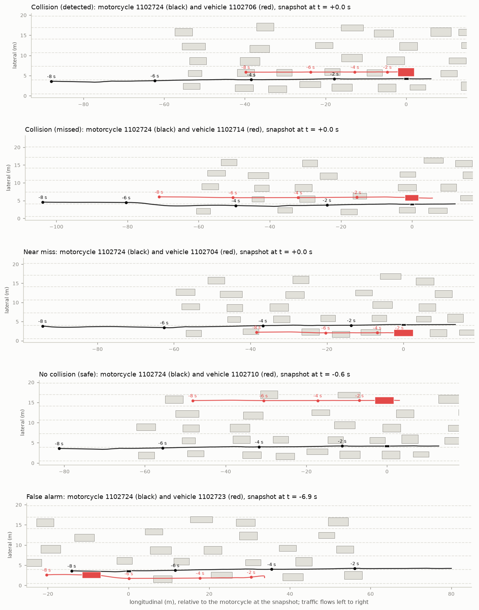

*Top-down view of each encounter. Boxes are to scale at the snapshot time; grey are the
other vehicles within 60 m. The lines are the paths over −8 s to +1 s, with dots every
2 s. Dashed lines are approximate lane boundaries. Boxes are centred on the tracked
point, as the risk measures treat them.*

What the view shows:
- **Lane filtering:** the motorcycle (black) rides along the boundary between lanes 1
  and 2, at about 4 m lateral. Over 8 s it covers 80–100 m while the cars beside it crawl
  at 0–6 m/s, so it passes car after car within 2 m.
- **Safe neighbour:** the car is three lanes away, about 11 m across.
- **False alarm:** a car directly behind in the motorcycle's lane, about 9 m back, moving
  at the same speed.

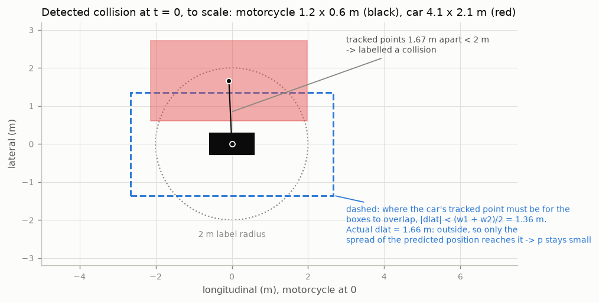

**Why a "collision" is not an overlap.**
- The label calls a pair a collision when the two tracked points come within 2 m: here
  1.67 m.
- The probability measures instead ask whether the vehicles' **boxes** overlap. That
  needs the lateral offset to be below the summed half-widths, (0.6 + 2.1)/2 = 1.36 m.
- The actual lateral offset is 1.66 m, so the boxes stay about 0.3 m apart.
- At t = 0 the predicted position's *spread* is all that can reach the overlap region,
  so the probability is small (median 0.083 under `cv`).

The risk is highest 1–4 s earlier, while the predicted paths still converge and the
Gaussian is wider. This applies to all three event cases: they are side-by-side passes,
not rear-end approaches.

---

## 5. Results at a glance

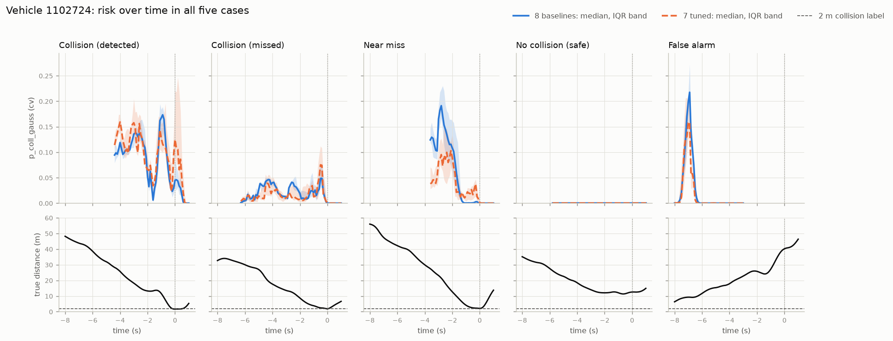

*Each column is one encounter. Top: `p_coll_gauss` under `cv`, with the median (line) and
interquartile range (band) of the 8 baselines (blue) and the 7 tuned models (orange,
dashed). Bottom: true distance between the two vehicles, with the 2 m label line.*

**Per-model statistics, median over the 15 models (range in brackets):**

| case | source | windows scored | peak p_coll_gauss | models reaching 0.1 | first time ≥ 0.1 | time of peak | p at t = 0 |
|---|---|---|---|---|---|---|---|
| collision (detected) | cv | 60 % | 0.187 [0.113, 0.467] | 15 / 15 | −4.4 s | −1.1 s | 0.083 |
| | pred | 33 % | 0.231 [0.145, 0.621] | 15 / 15 | −1.2 s | −0.2 s | 0.167 |
| collision (missed) | cv | 81 % | 0.069 [0.044, 0.188] | 4 / 15 | — | −0.5 s | 0.001 |
| | pred | 63 % | 0.119 [0.030, 0.386] | 11 / 15 | −0.6 s | −0.3 s | 0.080 |
| near miss | cv | 52 % | 0.178 [0.079, 0.298] | 13 / 15 | −3.6 s | −2.8 s | 0.000 |
| | pred | 51 % | 0.150 [0.068, 0.909] | 8 / 15 | −2.6 s | −1.7 s | 0.018 |
| no collision (safe) | cv | 76 % | 0.000 [0.000, 0.000] | 0 / 15 | — | — | 0.000 |
| | pred | 0 % | never in the scene | — | — | — | — |
| false alarm | cv | 56 % | 0.217 [0.027, 0.296] | 13 / 15 | −7.3 s | −6.9 s | (not scored) |
| | pred | 47 % | 0.278 [0.006, 0.571] | 9 / 15 | −8.0 s | −7.2 s | (not scored) |

"first time ≥ 0.1" is the median over the models that reach 0.1. The full per-model table
is `experiments/results/risk_timeline/summary.csv`.

**Reading the table:**
1. **Ordering by case:** under `cv`, collision > near miss > missed > safe, but the false
   alarm tops them all. Under `pred` the median ordering is the same, but the false-alarm
   range runs from 0.006 to 0.571. Some models avoid it and most do not (§7).
2. **The warning time is capped by when the pair is scored.**
   - All 15 models cross 0.1 at −4.4 s in the collision case. That is the first window in
     which the car is among the motorcycle's 15 nearest; 28 m separate them then.
   - Under `pred` the same crossing comes at −1.2 s, when the scene first selects the car.
   - So the 4.4 s figure says more about the candidate rule than about the models.
3. **The risk is gone by t = 0.** In every event case the median p at t = 0 is below
   0.17, and below 0.01 for the near miss. This is the side-by-side geometry of §4.

---

## 6. Each case in detail

Each case gets two figures, one per source. Each figure has one panel per architecture
(blue: baseline, dashed orange: tuned; traj_mamba has no tuned version) and the true
distance underneath. Within a source, every case shares one y-range, so heights compare
across cases. "scored" in a panel title is the share of the 91 windows in which the
case's pair was evaluated; a gap in a line is an unscored window.

### 6.1 Collision (detected): 1102724 vs 1102706

| `cv` | `pred` |
|---|---|
| 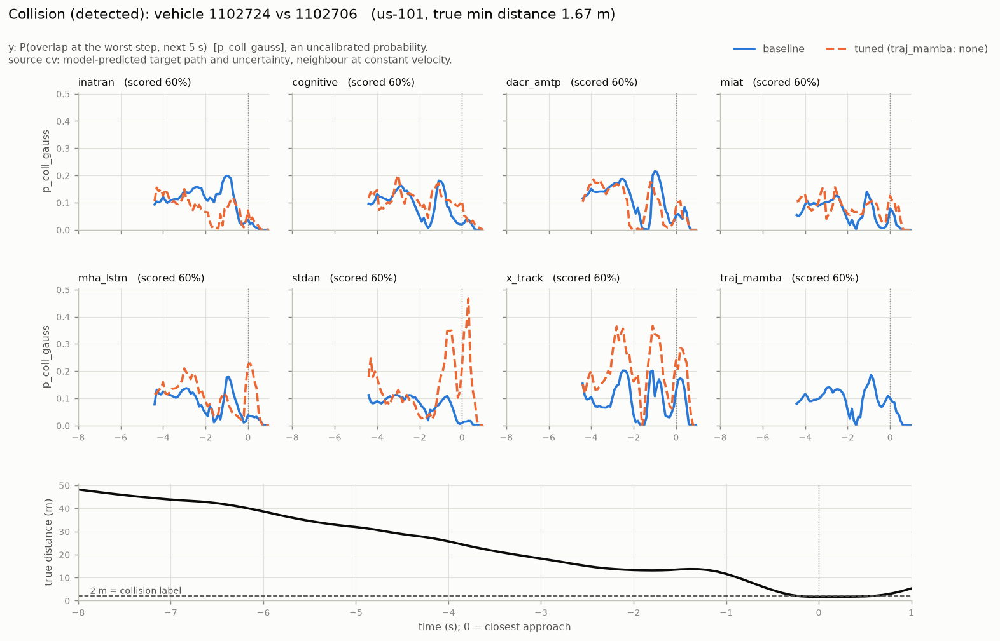 | 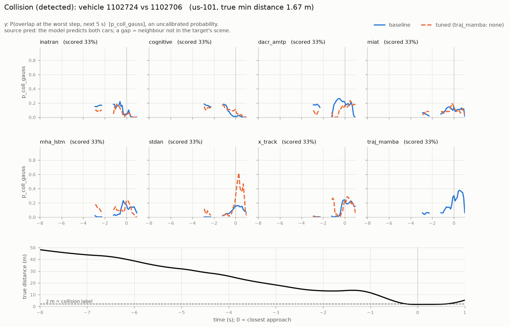 |

- The motorcycle closes from 48 m to 1.67 m in 8 s; the car is nearly stationary.
- Under `cv`, every model sits at 0.1–0.2 from −4.4 s. The curves dip at −1.7 s, when
  the true gap briefly stops shrinking (bottom panel, 13 m), then peak again near −1 s.
- **stdan_tuned peaks highest:** 0.47 under `cv` and 0.62 under `pred`. x_track_tuned is
  next under `cv` (0.37).
- Under `pred` the car enters the scene twice, briefly at −3 s and then from −1.2 s. Most
  models score it at 0.15–0.26 before the pass.

### 6.2 Collision (missed): 1102724 vs 1102714

| `cv` | `pred` |
|---|---|
| 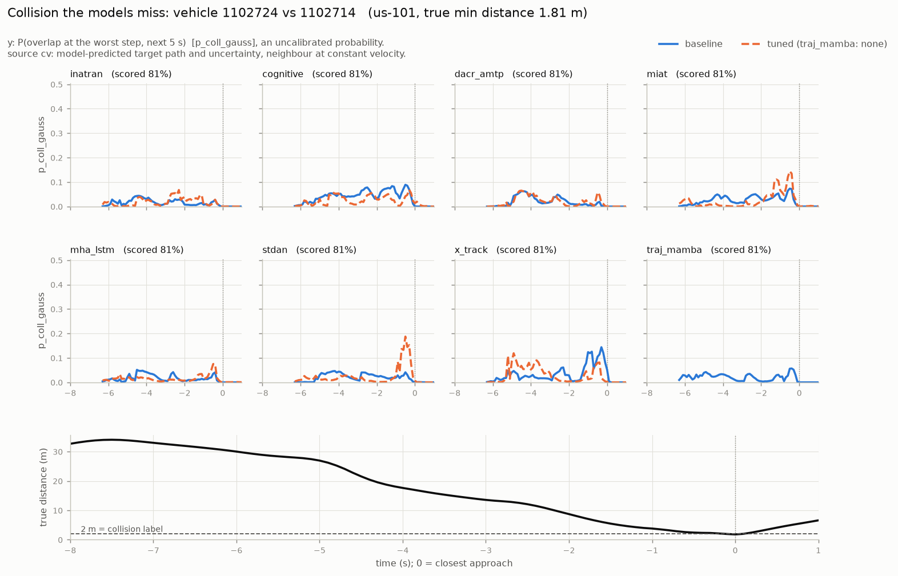 | 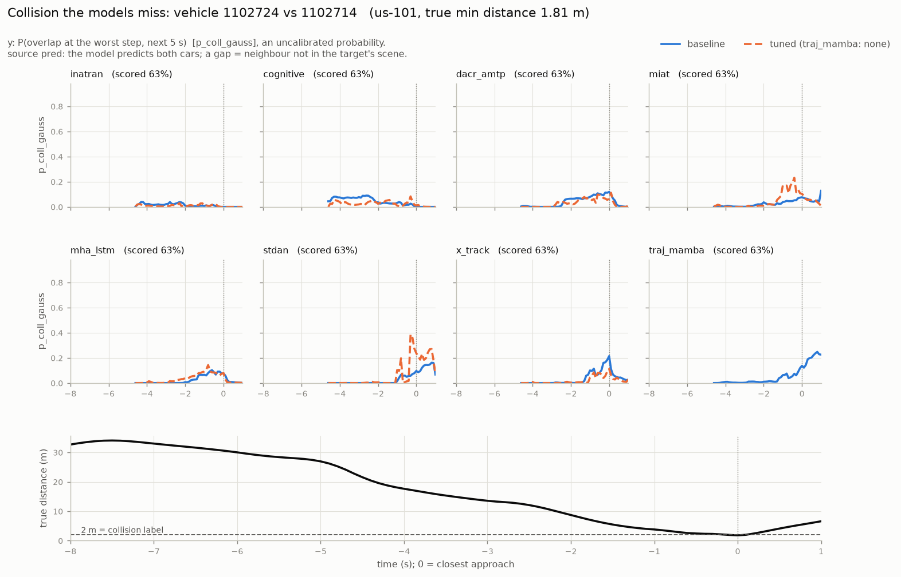 |

- The motorcycle passes a car moving at 6.3 m/s while doing 13.2 m/s. The car is in the
  next lane, 1.81 m across at the pass.
- **Under `cv`**, 11 of 15 models never reach 0.1; the median peak is 0.069.
  - The four that do are miat_tuned, stdan_tuned, x_track and x_track_tuned.
  - The predicted *path* does come within 1.85 m (§8), but the spread near the pass is
    too narrow to reach the overlap region of §4.
- **Under `pred`**, 11 of 15 reach 0.1, but only in the last second before the pass.
  stdan_tuned reaches 0.39.

### 6.3 Near miss: 1102724 vs 1102704

| `cv` | `pred` |
|---|---|
| 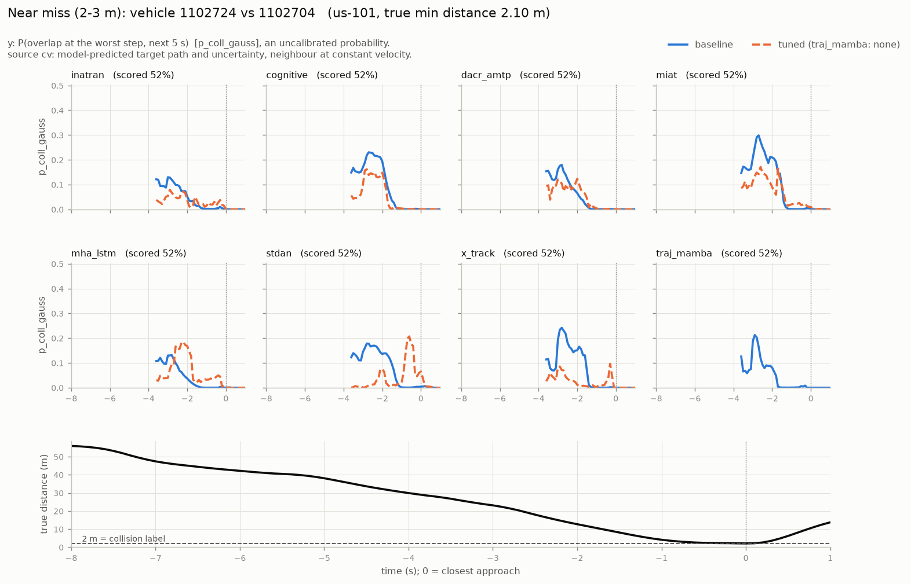 | 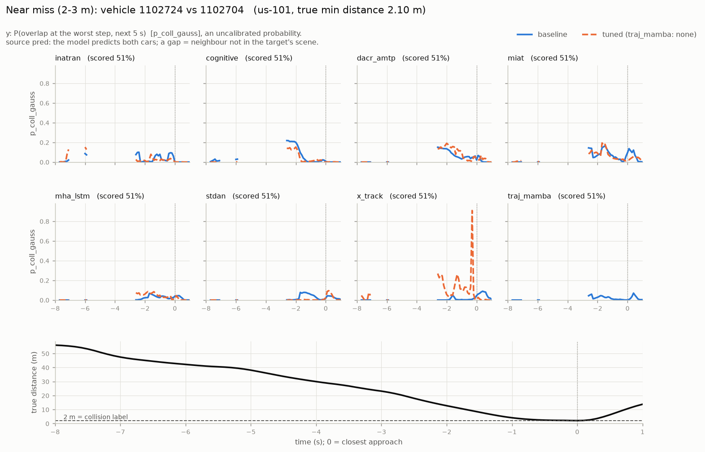 |

- A stationary car in the next lane; the motorcycle passes it 2.10 m across, which is
  outside the 2 m label.
- The risk rises 3–4 s before the pass (median peak 0.178 at −2.8 s) and is gone by
  −1.5 s, well before the closest point.
- **The baselines rate it higher than the tuned models:** median baseline peak 0.20,
  tuned 0.16.
- Under `pred`, x_track_tuned reaches **0.91**, the highest value in these timelines.
  One model's neighbour prediction swings into the stationary car.

### 6.4 No collision (safe): 1102724 vs 1102710

| `cv` | `pred` |
|---|---|
| 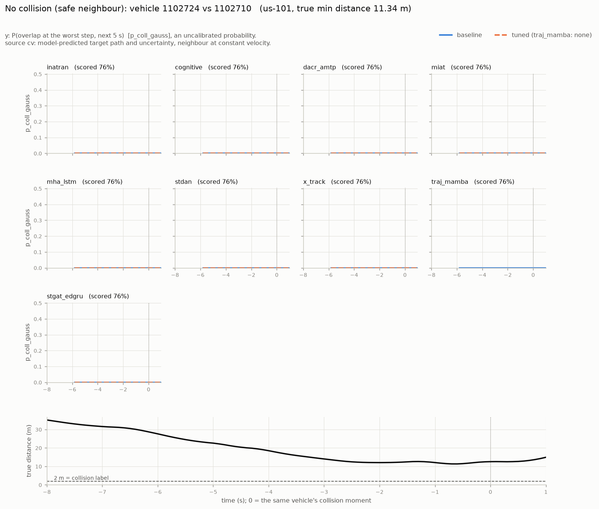 | 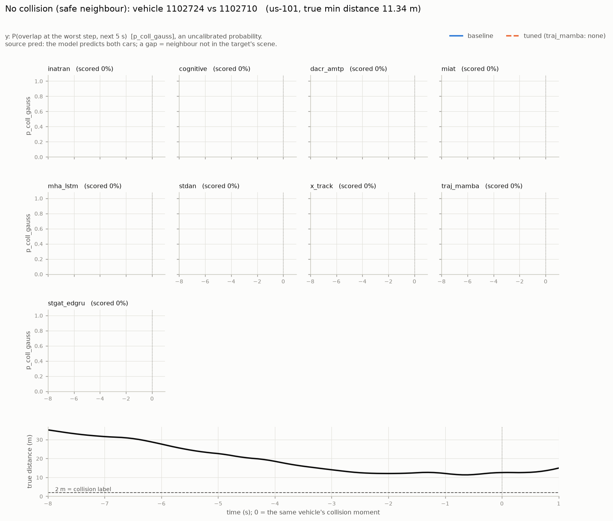 |

- A car three lanes away, never closer than 11 m.
- **`cv`:** every model, every window: p = 0.000.
- **`pred`:** the car never enters the motorcycle's risk-selected scene, so `pred` never
  scores it (the empty figure). The scene filter has already decided it is not
  interacting.

### 6.5 False alarm: 1102724 vs 1102723

| `cv` | `pred` |
|---|---|
| 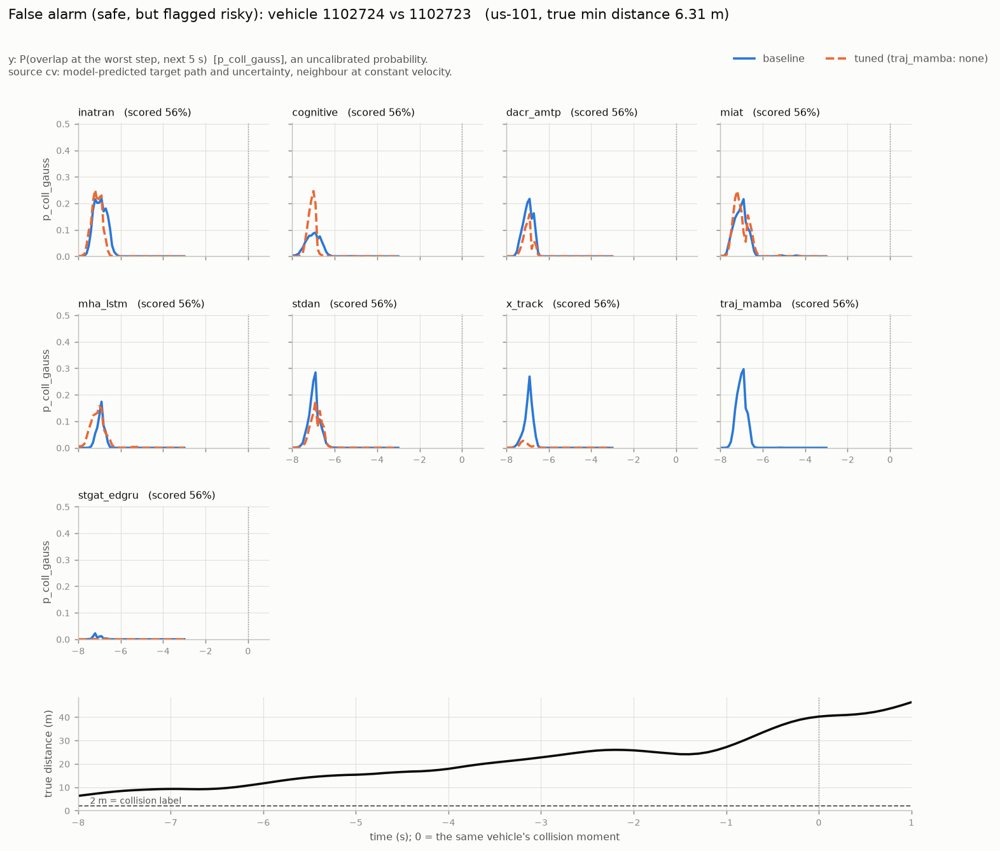 | 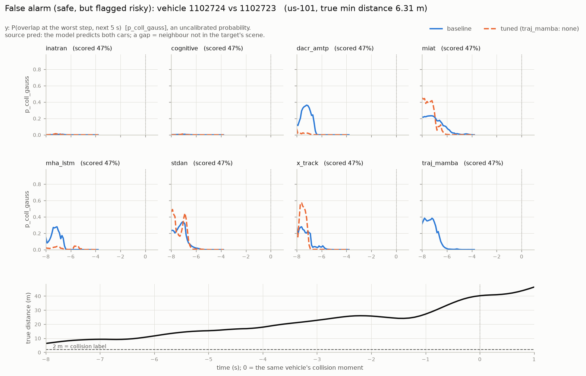 |

- A car directly behind the motorcycle, in the same lane, 9 m back and at the same speed
  (10.7 vs 10.9 m/s). The gap then opens to 40 m: the true minimum over the next 5 s is
  never below 6 m.
- **Under `cv`**, 13 of 15 models put p = 0.15–0.30 on it at −7 s, a sharp spike
  lasting about 0.5 s.
- **The alarm comes from the spread, not the path.** The predicted mean path never comes
  closer than 3.3 m, and `tet` stays at 0 (§8). Only the width of the predicted Gaussian
  over 5 s reaches the following car's box.
- **Under `pred`, the models split** (§7).

---

## 7. Model by model

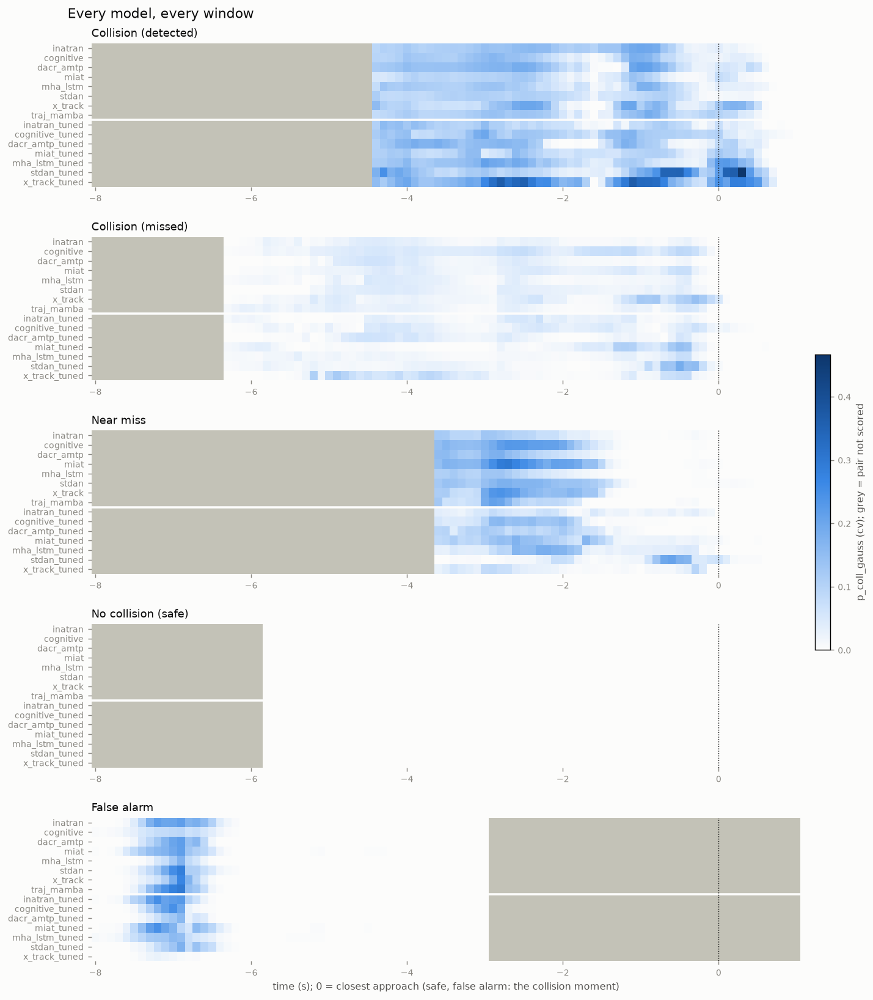

*Each row is a model (baselines above the white line, tuned below). Each column is a
0.1 s window; colour is `p_coll_gauss` under `cv`, on one scale for all panels. Dark grey
means the pair was not scored in that window.*

**Peak `p_coll_gauss` per model:**

| model | collision cv | collision pred | missed cv | missed pred | near miss cv | near miss pred | false alarm cv | false alarm pred |
|---|---|---|---|---|---|---|---|---|
| inatran | 0.199 | 0.219 | 0.044 | 0.040 | 0.130 | 0.100 | 0.218 | **0.006** |
| cognitive | 0.181 | 0.184 | 0.089 | 0.090 | 0.230 | 0.218 | 0.090 | **0.006** |
| dacr_amtp | 0.215 | 0.264 | 0.063 | 0.119 | 0.180 | 0.150 | 0.217 | 0.362 |
| miat | 0.140 | 0.145 | 0.073 | 0.128 | 0.298 | 0.166 | 0.216 | 0.232 |
| mha_lstm | 0.178 | 0.231 | 0.051 | 0.103 | 0.131 | 0.068 | 0.174 | 0.279 |
| stdan | 0.113 | 0.160 | 0.046 | 0.161 | 0.178 | 0.078 | 0.284 | 0.338 |
| x_track | 0.202 | 0.242 | 0.144 | 0.214 | 0.242 | 0.090 | 0.269 | 0.278 |
| traj_mamba | 0.187 | 0.375 | 0.057 | 0.248 | 0.212 | 0.070 | 0.296 | 0.384 |
| inatran_tuned | 0.155 | 0.184 | 0.068 | 0.030 | 0.079 | 0.152 | 0.251 | **0.017** |
| cognitive_tuned | 0.200 | 0.173 | 0.069 | 0.083 | 0.162 | 0.152 | 0.246 | **0.009** |
| dacr_amtp_tuned | 0.186 | 0.235 | 0.065 | 0.112 | 0.123 | 0.190 | 0.159 | 0.075 |
| miat_tuned | 0.156 | 0.197 | 0.144 | 0.232 | 0.171 | 0.194 | 0.247 | 0.451 |
| mha_lstm_tuned | 0.228 | 0.235 | 0.075 | 0.143 | 0.184 | 0.086 | 0.157 | 0.044 |
| stdan_tuned | 0.467 | 0.621 | 0.188 | 0.386 | 0.207 | 0.095 | 0.177 | 0.490 |
| x_track_tuned | 0.366 | 0.284 | 0.119 | 0.111 | 0.097 | 0.909 | 0.027 | 0.571 |

What the table shows:
1. **Under `pred`, inatran and cognitive are the only models that are right about both
   the collision and the false alarm**, in both their baseline and tuned versions.
   - Collision: 0.17–0.22. False alarm: 0.006–0.017.
   - These two lead the aggregate `pred` ranking (ROC-AUC 0.914 and 0.898, RISK_TUNING
     §5.4). On this vehicle the reason is visible: their predictions of the following car
     do not run it into the motorcycle.
2. **Many models score the false alarm at least as high as the collision:** 10 of 15
   under `cv` and 8 of 15 under `pred`. This fits §5.8 of the tuning study: no
   probability measure is calibrated, and tuning raised the probability given to safe
   pairs in six of seven models.
3. **stdan_tuned and x_track_tuned give the most extreme values in both directions.** They
   have the highest collision peaks, x_track_tuned has the near-miss 0.91, and both put
   about 0.5 on the false alarm under `pred`.
   - These are two of the lowest-RMSE models in the study (2.004 and 2.000 m).
   - They rank 13th and 15th of 15 for risk in the aggregate (RISK_TUNING §5.4), and here
     they are the least discriminating.
4. **Baseline vs tuned, on this vehicle:**
   - Tuning raises the collision peak in 9 of 14 comparisons (7 pairs × 2 sources).
   - It raises the false-alarm peak under `pred` for miat, stdan and x_track, and lowers
     it for dacr_amtp and mha_lstm. inatran and cognitive rise slightly but stay below
     0.02.
   - With one vehicle, this is illustration, not evidence. The aggregate comparison with
     confidence intervals is RISK_TUNING §5.2.

---

## 8. The other risk measures over time

The same windows were scored with the study's six headline measures. Each has its own
unit and its own "riskier" direction, so each gets its own row and y-axis. Nothing is
put on a shared or second axis.

| measure | what it is, per window | unit | riskier when |
|---|---|---|---|
| `p_coll_gauss` | worst single-step box-overlap probability (§2.2) | probability | higher |
| `p_coll_mc` | any-step box-overlap probability, Monte Carlo (§2.2) | probability | higher |
| `s_field_cal` | calibrated S risk field from bumper-to-bumper gaps and speed, max over 5 s | field value, saturates near 1 | higher |
| `min_dist` | predicted minimum centre distance over 5 s | m | lower |
| `ttc_true` | predicted time until the boxes touch under the predicted motion; none if they never do | s | lower |
| `tet` | predicted time spent closer than 2 m within the 5 s | s | higher |

The probabilities use the model's predicted **spread** (σ). The other four use only the
predicted **mean path**.

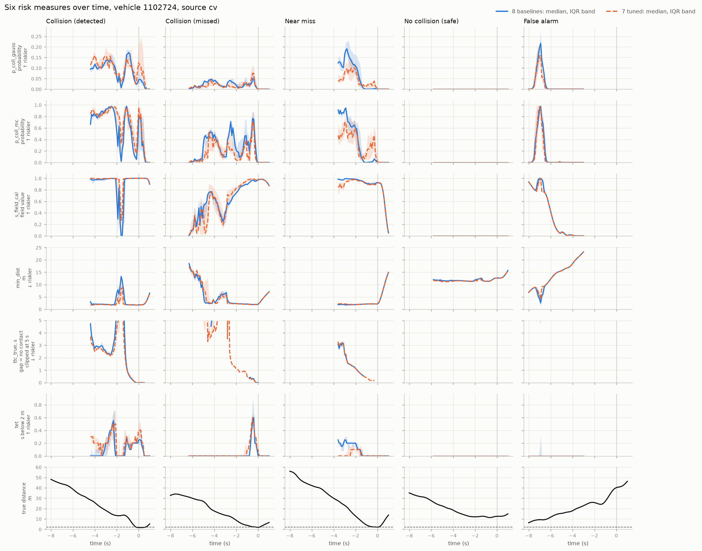

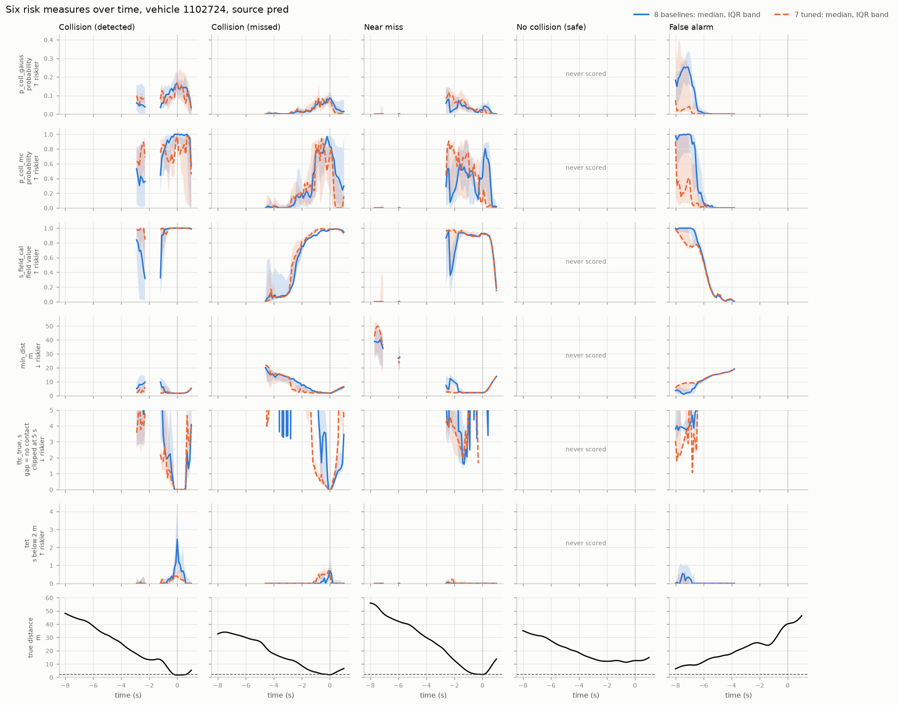

*Rows: the six measures, then the true distance. Columns: the five encounters. Lines are
the median and bands the IQR over the 8 baselines (blue) and the 7 tuned models (orange,
dashed). `ttc_true` is clipped at the 5 s horizon: values far beyond it occur, and a gap
means no contact predicted.*

**Median over the 15 models, `cv`, extreme value of each measure over the timeline:**

| case | true min distance | `p_coll_gauss` max | `p_coll_mc` max | `s_field_cal` max | `min_dist` min | `ttc_true` min | `tet` max | first window with predicted `min_dist` < 2 m |
|---|---|---|---|---|---|---|---|---|
| collision (detected) | 1.67 m | 0.148 | 0.969 | 1.00 | 1.69 m | 0.0 s | 0.50 s | −4.4 s |
| collision (missed) | 1.81 m | 0.058 | 0.719 | 0.98 | 1.85 m | 0.0 s | 0.60 s | −0.8 s |
| near miss | 2.10 m | 0.149 | 0.875 | 0.98 | 1.86 m | 0.1 s | 0.20 s | −3.6 s |
| no collision (safe) | 11.3 m | 0.000 | 0.000 | 0.00 | 11.34 m | 25.7 s | 0.00 s | never |
| false alarm | 6.3 m | **0.197** | **0.953** | **1.00** | **3.29 m** | **5.4 s** | **0.00 s** | never |

What the six measures show together:
1. **The false alarm comes from the predicted spread, not the predicted path.**
   - The mean-path measures all rate the following car as safe: predicted `min_dist`
     ≥ 3.3 m, no time below 2 m (`tet` = 0), and no contact within the horizon
     (`ttc_true` ≥ 5.4 s).
   - The two probabilities and the risk field flag it. The probabilities do so because
     the 5 s Gaussian is wide enough to reach the car's box.
   - The model's uncertainty, not its trajectory, raises the alarm.
2. **The "missed" collision is missed only by the probabilities.**
   - From −0.8 s the predicted `min_dist` is below 2 m, `tet` reaches 0.6 s and
     `ttc_true` reaches 0.
   - The mean path puts the motorcycle beside the car, but the narrow late-horizon spread
     keeps the box-overlap probability low.
   - "Missed" means missed by `p_coll_gauss`, the measure the cases were ranked on.
3. **The mean-path measures over-call the near miss.** The predicted minimum is 1.86 m
   against a true 2.10 m, so a 2 m threshold on predicted `min_dist` would call it a
   collision. That is 0.24 m of error at the label boundary.
4. **`s_field_cal` saturates.** It sits near 1.0 for every encounter except the safe one,
   including the false alarm. The calibrated field mostly says "a vehicle is close
   ahead", which a congested lane always satisfies. It is the only one of the six that
   cannot tell the detected collision from the false alarm at all.
5. **Under `pred`** the picture is the same, with two differences. `ttc_true` dips to
   1–4 s on the false alarm for the tuned models. And `tet` reaches 2.5 s at the detected
   collision, because the predicted paths of both vehicles overlap for longer.

No single measure gets all five cases right on this vehicle. The mean-path measures
(`min_dist`, `tet`, `ttc_true`) are right on the safe case and the false alarm, catch both
collisions, and over-call the near miss by 0.24 m. The spread-based probabilities raise
the false alarm and miss one collision. That trade-off between using the predicted path
and using its uncertainty is the main lesson of this vehicle.

---

## 9. `p_coll_gauss` vs `p_coll_mc`

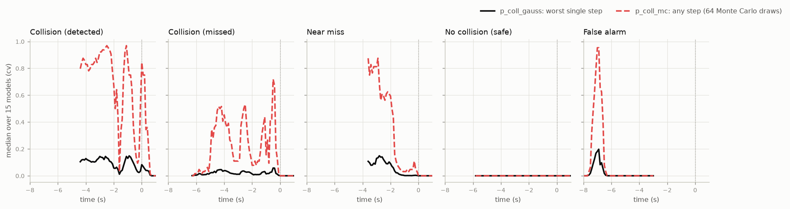

*Median over the 15 models, `cv`.*

The two "collision probabilities" differ by an order of magnitude on the same
predictions:
- detected collision: `p_coll_gauss` about 0.15, `p_coll_mc` about 0.95;
- false alarm: about 0.2 vs about 0.95.

They answer different questions. `p_coll_gauss` asks about the worst *single* step;
`p_coll_mc` asks about *any* step. And `p_coll_mc` draws its noise independently at each
step (§2.2), so 50 chances compound.

In the aggregate study `p_coll_gauss` ranks pairs slightly better for every baseline:
ROC-AUC 0.848–0.938 vs 0.824–0.921 under `pred`, and 0.960–0.966 vs 0.935–0.944 under
`cv`. Their *levels* differ far more than their rankings, so anyone reading p as a
probability must know which one they hold. `p_coll_mc` with temporally correlated noise, one draw per trajectory rather
than per step, would sit between the two. That is a possible improvement, not done here.

---

## 10. When each source can score the pair

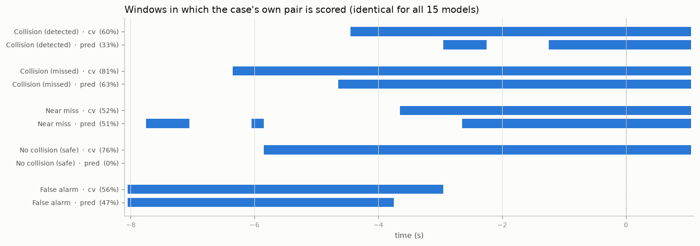

Coverage depends only on the data, not on the model, so it is identical for all 15.

- **`cv`** starts when the car becomes one of the motorcycle's 15 nearest vehicles. In
  dense congested traffic that happens late: the collision car enters at −4.4 s, 28 m
  away.
- **`pred`** starts when the car's S/O risk field crosses the scene-selection threshold.
  For the detected collision that is −1.2 s, apart from a brief flicker at −3 s. The safe
  neighbour never enters at all.

Consequence: **neither source can warn earlier than its candidate rule allows.** A
deployed system would need a wider candidate set (more than 15, or a distance radius) for
long lead times. Extending `pred` to every nearby vehicle would mean predicting each one
in its own scene, the fix proposed in RISK_TUNING §6.

---

## 11. Caveats

1. **One vehicle.** Everything here illustrates the aggregate results; it does not
   replace them. The ROC-AUC comparisons with event-bootstrap CIs are in
   RISK_TUNING_RESULTS §5.
2. **The vehicle is a motorcycle.** Lane filtering produces side-by-side passes, not
   rear-end conflicts. A car would show different geometry; a cars-only rerun is one flag
   away (`v_class != 1` in the candidate check).
3. **Surrogate labels.** "Collision" means tracked points within 2 m (§4). NGSIM has no
   real crashes.
4. **Uncalibrated probabilities** (§1): read heights as ranks within a model, not as
   frequencies.
5. **Bad tracks are filtered by a heuristic** (10–40 m apart 5 s before, ≥ 70 windows).
   It rejected 30 candidates (17 detected, 13 missed) ranked above the accepted ones.
   Other artefacts may remain.
6. **The safe and false-alarm cases come from the same window as the collision.** Their
   t = 0 is that collision's moment, not an event of their own.
7. **`p_coll_mc` is a 64-draw Monte Carlo**, so it moves in steps of 1/64 ≈ 0.016.

---

## 12. Reproducing

```bash
# local: rank the candidates from the committed risk_v2 npz files
python experiments/plot_risk_timeline.py --select

# lab PC (NGSIM + all 15 checkpoints): resolve the cases, score every 0.1 s window
ssh dslab 'cd ~/MTP && python3 experiments/plot_risk_timeline.py --score'    # ~5 min
ssh dslab 'cd ~/MTP && python3 experiments/plot_risk_timeline.py --tracks'   # raw positions
ssh dslab 'tar czf - -C ~/MTP experiments/results/risk_timeline' | tar xzf -  # box -> local only

# local: the per-case figures, then this document's figures and summary table
python experiments/plot_risk_timeline.py --plot                       # p_coll_gauss
python experiments/plot_risk_timeline.py --plot --metric min_dist     # any scored measure
python experiments/risk_timeline_figures.py
```

| artifact | path |
|---|---|
| candidate ranking (from the npz files) | `experiments/results/risk_timeline/cases.json` |
| chosen cases, rejected candidates and reasons | `experiments/results/risk_timeline/windows.json`, `plotted_cases.json` |
| scores: case × model × source × window × neighbour | `experiments/results/risk_timeline/scores.csv` |
| true distances | `experiments/results/risk_timeline/truth.csv` |
| raw positions within 60 m | `experiments/results/risk_timeline/tracks.csv` |
| per-model summary | `experiments/results/risk_timeline/summary.csv` |
| per-case figures | `experiments/figures/risk_timeline_<case>_<source>_<metric>.png` |
| this document's figures | `experiments/figures/risk_timeline_doc_*.png` |
| code | [`plot_risk_timeline.py`](experiments/plot_risk_timeline.py), [`risk_timeline_figures.py`](experiments/risk_timeline_figures.py) |
| test | [`tests/test_risk_timeline.py`](tests/test_risk_timeline.py) |
| run log | `experiments/runs/risk_timeline.out` |

---

## 13. STGAT-EDGRU and the Collision Risk Index on the five encounters

Added after the study: the STGAT-EDGRU model of Su et al. (Electronics 2025) and its Collision
Risk Index (CRI), in two versions: `cri_paper` exactly as printed, and `cri_fixed` with the
paper's variance (Eq. 29) and intensity (Eq. 32) errors corrected. Model, CRI definition and
aggregate results are in [STGAT_EDGRU.md](STGAT_EDGRU.md).

The five cases are unchanged:
- They were chosen from the original 15 models (`SELECTION_MODELS` in
  `plot_risk_timeline.py`), so adding a model cannot move them.
- Rescoring with the CRI columns reproduced every one of the 15 models' 93,480 existing
  values exactly.
- Every table and summary figure in §§1–12 is still drawn from those 15 models only. The
  one exception is the per-model case figures in §6, which gain a STGAT-EDGRU panel (see
  the end of this section); their other eight panels are unchanged.

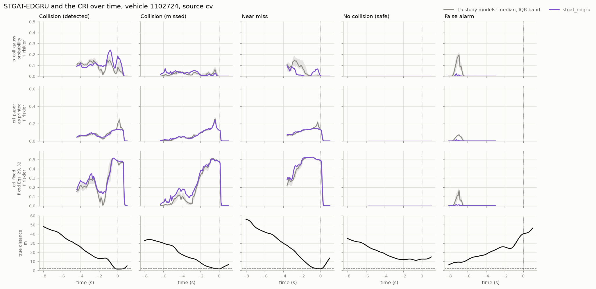

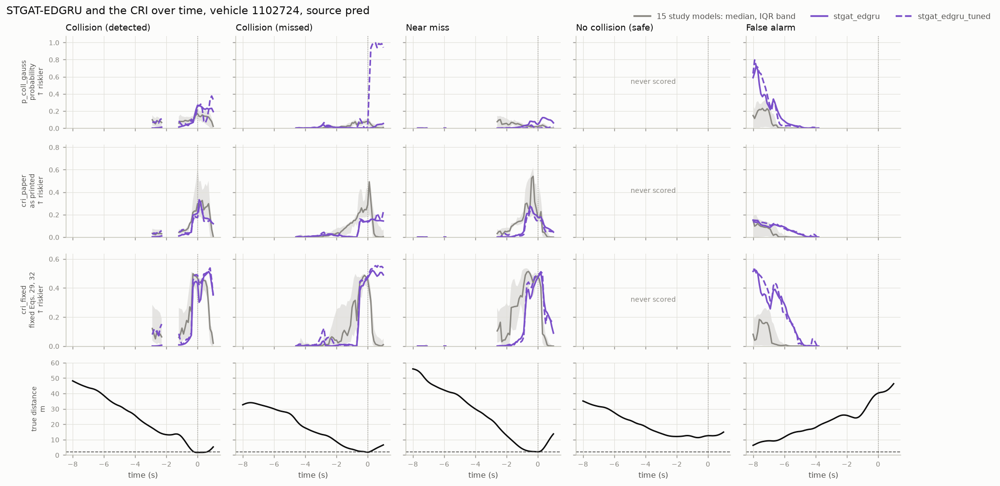

*Grey: median and IQR band of the 15 study models. Purple: STGAT-EDGRU (solid) and
STGAT-EDGRU tuned (dashed, [RISK_TUNING_RESULTS.md](RISK_TUNING_RESULTS.md) §10). Rows:
`p_coll_gauss`, the two CRIs, true distance.*

**Peak values per case**, STGAT-EDGRU against the 15 study models (median [range]):

| case | source | `p_coll_gauss` STGAT | `p_coll_gauss` 15 models | `cri_paper` STGAT | `cri_paper` 15 models | `cri_fixed` STGAT | `cri_fixed` 15 models |
|---|---|---|---|---|---|---|---|
| collision (detected) | cv | 0.240 | 0.187 [0.113, 0.467] | 0.136 | 0.256 [0.142, 0.434] | 0.516 | 0.514 [0.505, 0.550] |
| | pred | 0.268 | 0.231 [0.145, 0.621] | 0.332 | 0.487 [0.137, 0.759] | 0.514 | 0.512 [0.354, 0.562] |
| collision (missed) | cv | 0.069 | 0.069 [0.044, 0.188] | 0.240 | 0.253 [0.203, 0.585] | 0.507 | 0.518 [0.484, 0.528] |
| | pred | 0.054 | 0.119 [0.030, 0.386] | 0.161 | 0.493 [0.140, 0.644] | 0.521 | 0.503 [0.310, 0.580] |
| near miss | cv | 0.095 | 0.178 [0.079, 0.298] | 0.147 | 0.218 [0.154, 0.475] | 0.526 | 0.528 [0.519, 0.549] |
| | pred | 0.123 | 0.150 [0.068, 0.909] | 0.276 | 0.558 [0.190, 0.761] | 0.503 | 0.532 [0.351, 0.589] |
| no collision (safe) | cv | 0.000 | 0.000 | 0.000 | 0.000 | 0.000 | 0.000 |
| false alarm | cv | **0.022** | 0.217 [0.027, 0.296] | 0.016 | 0.077 [0.025, 0.113] | 0.013 | 0.169 [0.010, 0.251] |
| | pred | **0.727** | 0.278 [0.006, 0.571] | 0.151 | 0.151 [0.002, 0.390] | 0.522 | 0.225 [0.003, 0.496] |

**The tuned model** (`stgat_edgru_tuned`), peaks, baseline → tuned:

| case | source | `p_coll_gauss` | `cri_paper` | `cri_fixed` |
|---|---|---|---|---|
| collision (detected) | cv | 0.240 → 0.282 | 0.136 → 0.155 | 0.516 → 0.520 |
| | pred | 0.268 → 0.376 | 0.332 → 0.267 | 0.514 → 0.538 |
| collision (missed) | cv | 0.069 → 0.105 | 0.240 → 0.202 | 0.507 → 0.509 |
| | pred | 0.054 → **0.998** (at +0.4 s) | 0.161 → 0.226 | 0.521 → 0.561 |
| near miss | cv | 0.095 → **0.016** | 0.147 → 0.157 | 0.526 → 0.524 |
| | pred | 0.123 → 0.036 | 0.276 → 0.255 | 0.503 → 0.512 |
| no collision (safe) | cv | 0.000 → 0.000 | 0.000 → 0.000 | 0.000 → 0.000 |
| false alarm | cv | 0.022 → **0.003** | 0.016 → 0.001 | 0.013 → 0.004 |
| | pred | 0.727 → **0.796** | 0.151 → 0.137 | 0.522 → 0.529 |

What this adds:
1. **STGAT-EDGRU is the extreme case of §7's split between sources, and tuning sharpens
   it.**
   - Under `cv` it gives the false alarm 0.022, lower than all 15 study models, while
     flagging the collision at 0.240. The tuned version goes lower
     still, to 0.003, and raises the collision to 0.282.
   - Under `pred` it gives the false alarm **0.727**, higher than all 15 study models
     (x_track_tuned had 0.571), from −8 s. It predicts the following car into the
     motorcycle. The tuned version gives 0.796.
   - The tuned `p_coll_gauss` is sharper in both directions: it drops the near miss to 0.016
     under `cv` (the median model gives 0.178), and under `pred` it jumps to 0.998 on the
     missed collision, but only at +0.4 s, after the closest approach.
   - This is its aggregate result on one vehicle: mid-table under `cv`, 15th–16th of 17
     under `pred` (STGAT_EDGRU.md §5–6).
2. **Under `cv`, the CRI never confuses the false alarm with an event, for any model.**
   - In all 17 models, both CRIs score each of the three events above the false alarm.
     `cri_fixed` peaks at 0.48–0.55 on every event, and at most 0.25 on the false alarm.
   - `p_coll_gauss` manages this in only 4 of 17 models (STGAT-EDGRU and its tuned version,
     x_track_tuned and stdan_tuned). It scored the false alarm at least as high as the
     collision in 10 of 15 (§7).
   - Two parts of the CRI do this. It averages over the horizon (α1 · mean + α2 · max), so a
     risk that exists only in the widened 5 s tail counts less. And `cri_fixed`'s intensity
     is near zero for a car at the motorcycle's own speed.
3. **But the CRI cannot tell the three events apart.**
   - `cri_fixed` sits at 0.50–0.53 for the detected collision, the missed collision and the
     near miss alike.
   - Once the predicted centres stay inside the Eq. 30 circle (2.8–3.4 m for this
     motorcycle and these cars), P = 1, and the score is just the intensity profile.
   - It separates "close encounter" from "not", not "collision" from "near miss".
4. **Under `pred` the CRI's advantage shrinks.** The false-alarm range reaches 0.39
   (`cri_paper`) and 0.50 (`cri_fixed`), as high as the events. When the model predicts the
   following car into the motorcycle, every measure follows it. All three events still beat
   the false alarm in 15 of 17 models for `cri_paper` and 14 of 17 for `cri_fixed`, against
   6 of 17 for `p_coll_gauss`.

The per-model panels of the case figures (§6, `risk_timeline_<case>_<source>_<metric>.png`)
now carry a ninth panel for STGAT-EDGRU, baseline and tuned. Plot either CRI there with
`plot_risk_timeline.py --plot --metric cri_fixed` (or `cri_paper`); those figures are
committed too.

Reproduce: `plot_risk_timeline.py --score` on the box (all models, or `--models stgat_edgru`
with the existing CSVs), then `risk_timeline_figures.py` locally. The per-model peaks,
including `cri_paper_peak`/`cri_fixed_peak`, are in `summary.csv`.
