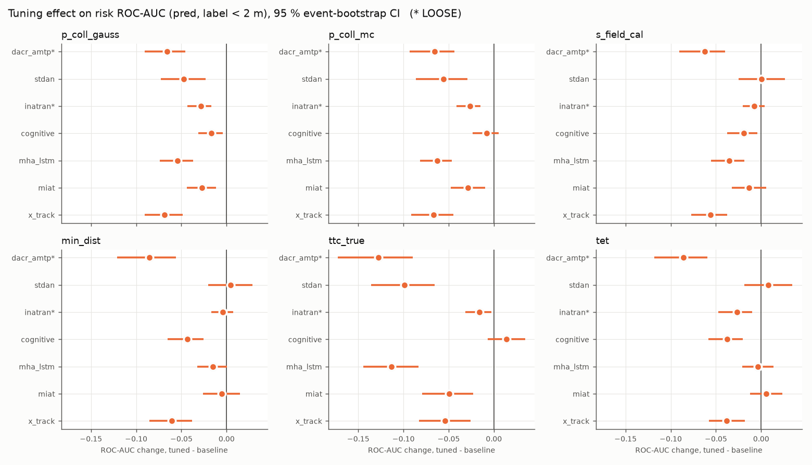
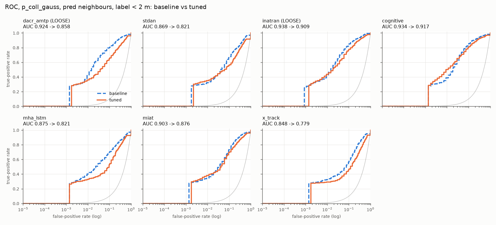
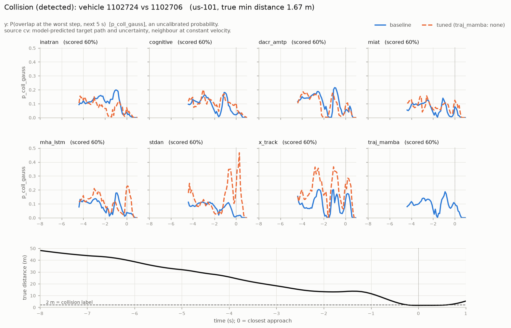
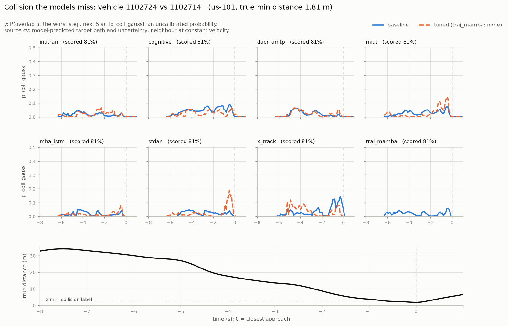
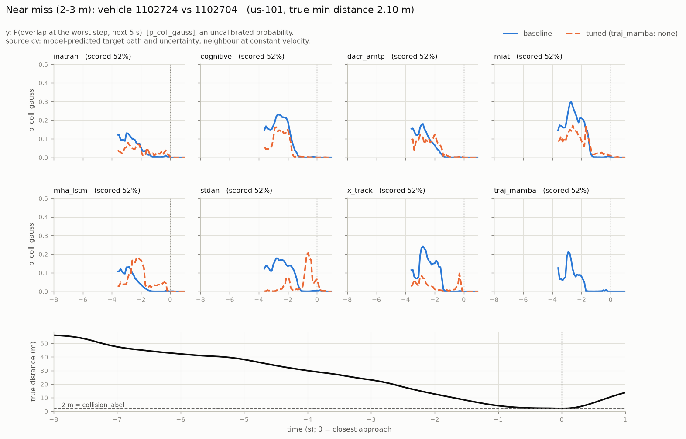
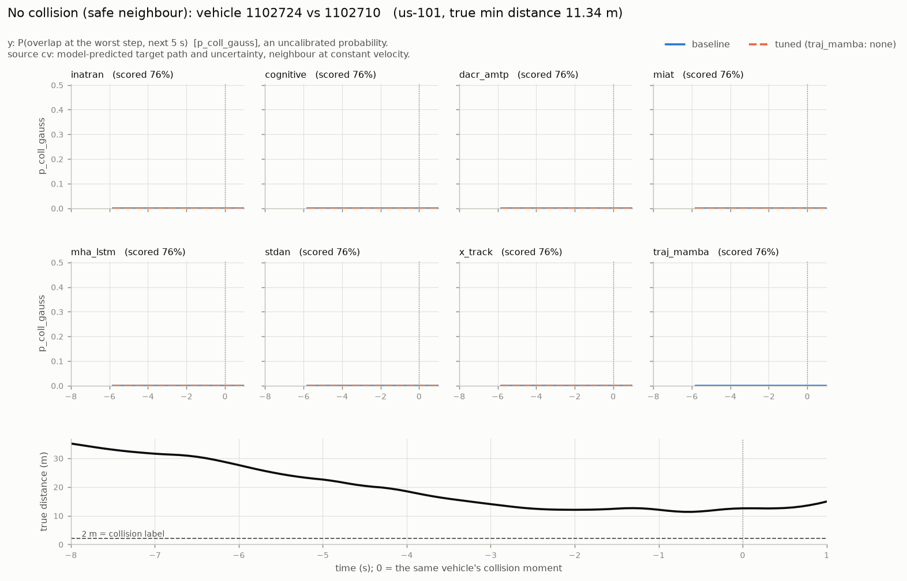
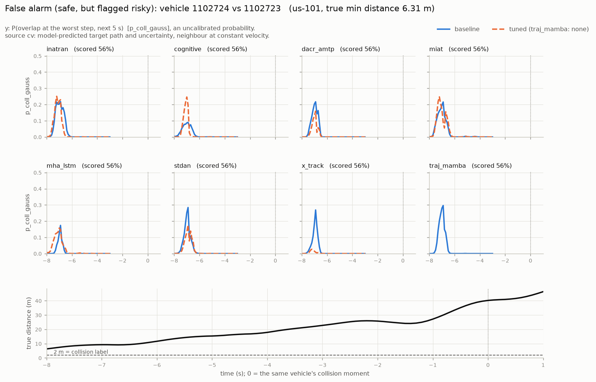

# Hyperparameter Tuning of the Best Models, and What It Does to Risk Prediction

Companion to [RISK_PREDICTION_RESULTS.md](RISK_PREDICTION_RESULTS.md) (protocol, the 30 risk
measures, the four neighbour sources) and
[RISK_PREDICTION_METHODOLOGIES.md](RISK_PREDICTION_METHODOLOGIES.md) (the method catalogue).
Section numbers like "§2.1b" refer to RISK_PREDICTION_RESULTS.md.

---

## Summary

- **Tuning works for trajectories.** All seven tuned models improve test RMSE by 2.1–5.2 %,
  and all seven now beat every untuned model in the 39-model benchmark. x_track reaches
  **1.9998 m**, the first model below 2 m. The gain does not come from architecture: every
  search found the same fix, a much slower learning-rate decay (0.76–0.88 per epoch instead of
  0.6) over 16–30 epochs. The default schedule had been freezing every model before it
  converged.
- **Tuning makes risk prediction worse.** With model-predicted neighbours (`pred`), the
  headline risk ROC-AUC **falls for all seven models** (−0.018 to −0.082). Every paired,
  event-clustered 95 % CI excludes zero. On the matched constant-velocity control
  (`cv_scene`), the changes are within ±0.01. The loss is entirely in how the tuned models
  predict *neighbours*, not in the target trajectory that RMSE measures.
- **Better trajectories, worse risk.** Ranked by `pred` risk accuracy, x_track_tuned, the
  best trajectory model in the study, comes last of 15. Rank correlation between risk
  accuracy and RMSE is **negative**: Spearman −0.45 for baselines, −0.54 for tuned models at
  2 m. RMSE is not just a poor guide to risk accuracy here; optimising it moved risk the
  wrong way.
- **The baseline risk ranking is now statistically supported.** Paired event-bootstrap CIs
  separate inatran > cognitive > dacr_amtp > miat > stdan > traj_mamba. Only miat vs
  mha_lstm and traj_mamba vs x_track are within noise. This closes the open caveat of the
  first study (§6 item 13).
- **traj_mamba** was stopped by request at 20 of 30 trials. It was not retrained, and it
  appears below only as a baseline.

---

## 1. Why tune, and which models

Every model in the 39-model benchmark was trained on one fixed budget: 12 epochs, Adam
lr 5e-4 decayed ×0.6 per epoch, batch 128, weight decay 1e-5. That is fair across models,
but it leaves each model wherever the budget happened to stop it. Three of the risk leaders
reached their best validation loss at **epoch 12 of 12** (dacr_amtp, inatran, cognitive),
so the risk ranking in §5.3 could partly reflect how well each architecture suits the
default schedule.

This study tunes the training hyperparameters of the best models, retrains each on its best
setting, and re-scores the full risk suite for baseline and tuned versions side by side, on
identical pair sets. It also closes two gaps the first study left open. ROC curves are now
saved, not only their area. Every AUC now carries an event-clustered bootstrap CI (§6 item
13), and pairwise model differences carry paired CIs.

**Models: the union of two top-5 lists, 8 models; 7 tuned to completion.**

| model | risk rank¹ | RMSE rank² | set | fidelity | baseline train min | status |
|---|---|---|---|---|---|---|
| inatran | 1 (0.914) | 8 | risk | **LOOSE** | 18 | tuned |
| cognitive | 2 (0.898) | 7 | risk | Interpretation | 20 | tuned |
| dacr_amtp | 3 (0.869) | 4 | risk + RMSE | **LOOSE** | 17 | tuned |
| miat | 4 (0.832) | 1 | risk + RMSE | Paper description | 38 | tuned |
| mha_lstm | 5 (0.821) | 10 | risk | Paper description | 24 | tuned |
| stdan | 6 | 5 | RMSE | Paper baseline | 17 | tuned |
| x_track | 8 | 3 | RMSE | Paper description | 58 | tuned |
| traj_mamba | 7 | 2 | RMSE | Paper description | 189 | **stopped at 20/30, not retrained** |

¹ Mean `pred`-source ROC-AUC over the six headline measures (`p_coll_gauss`, `p_coll_mc`,
`s_field_cal`, `min_dist`, `ttc_true`, `tet`), label < 2 m, from the committed
`experiments/results/risk/`. ² Test `rmse_avg` in `experiments/comparison_rmse.csv`.

traj_mamba costs about 2.5 h per trial on a shared GPU, about 10× the others. It was stopped
by request after 40 h, with 20 finished trials (12 complete, 8 pruned, best subset val RMSE
2.044). Its partial study is kept in `experiments/tuning/traj_mamba/`. With no full-data
retrain there is no tuned model to score, so traj_mamba appears below only as a baseline.

---

## 2. Tuning protocol

| | |
|---|---|
| Search | Optuna TPE, 30 finished trials per model (complete + pruned) |
| Space | `learning_rate` 1e-4 – 2e-3 (log) · `lr_decay` 0.6 – 0.97 · `batch_size` {64, 128, 256} · `weight_decay` 1e-6 – 1e-3 (log) · `num_epochs` 12 – 30 · `dropout` 0 – 0.3 |
| Dropout | only for inatran, cognitive and miat. The other five notebooks have no dropout layer, and a dimension that does nothing would only dilute the search |
| Loss | each notebook's own (`use_risk_loss` as in its `HPARAMS`; all eight use the basic loss) |
| Trial data | a fixed, seeded 25 % of the train split (135,037 of 540,149 samples); scored on the full validation split (86,077) |
| Objective | minimum validation RMSE over the trial's epochs |
| Pruning | median pruner, 5 start-up trials, 3 warm-up epochs |
| Final model | one retrain on the **full** train split with the best trial's params. The checkpoint is chosen by lowest validation loss, the same rule as the baseline (S4), so tuned and baseline differ only in hyperparameters |
| Test split | untouched by tuning; read once, after the final retrain |

**Why validation RMSE, not a risk objective.** RMSE is reported every epoch, so pruning
works. It also keeps the risk evaluation out of model selection, so no risk number below was
tuned on. And the validation split holds only about 20 positive events at 2 m, too few to
steer a search. The cost is that this tuning was **not aimed at risk**. The first study had
already found RMSE and risk rank uncorrelated. §5 measures what tuning for RMSE did to risk.

**Fairness caveat.** These seven models now have about 30× the training budget of the other
32 in the benchmark. Tuned rows are compared with their own baselines, never ranked against
untuned models from the wider benchmark as if the budgets were equal.

**Shared sampler seed.** Every study used TPE seed 42, so all models were offered the same
first ten random configurations. That is fair across models, but less diverse than
independent seeds. It is why traj_mamba's best trial (#10) has exactly the same parameters
as dacr_amtp's best trial (#10): both studies ranked the identical first ten trials alike,
and TPE proposed the same eleventh.

### 2.1 Checkpointing, resume and progress

The run took two days on one GPU, so every level resumes from where it stopped:

| level | where the state lives | what a restart does |
|---|---|---|
| study | `experiments/tuning/<model>/optuna.db` (SQLite) | tops up to 30 finished trials |
| trial | `tuning/<model>/trial_<n>/last_checkpoint.pt`, written every epoch | a trial left RUNNING (kill, reboot) or FAIL with its checkpoint on disk (Ctrl-C) is re-queued with the same params and continues from its last epoch |
| final retrain | `experiments/checkpoints/<model>_tuned/last_checkpoint.pt` | continues from its last epoch |
| model | `experiments/results/<model>_tuned.json` | skipped |
| risk scoring | `experiments/results/risk_v2/<name>.json`, rewritten after every source | skips sources already scored |

Before the real run, both resume paths were tested by killing a process mid-trial: locally
on CPU and on the DSLab GPU. The rerun re-queued the trial and continued at the next epoch.
The same test caught a bug. A fixed sampler seed made a restarted study replay its first
trials. The sampler is now seeded with `42 + number of stored trials`, which keeps it
deterministic without repeats.

**Progress reporting:**
- tqdm bars for trials, epochs, batches and scored samples;
- `tune_top.py --status`: trials done / 30, pruned, failed, the running trial's epoch, best
  validation RMSE, final-retrain epoch, and an ETA from measured trial durations.

### 2.2 Running in parallel

The models are small (78 k – 254 k parameters), so one training process leaves the GPU
partly idle, and risk scoring is CPU-bound on scene construction. The work ran as concurrent
lanes on one DSLab machine (AMD EPYC 7313, 32 threads, 125 GB RAM, one RTX A5000 24 GB):

| lane | resource | work | wall-clock |
|---|---|---|---|
| g1 | GPU | traj_mamba, stopped at 20/30 | 40.4 h |
| g2 | GPU | mha_lstm → miat → x_track | 44.3 h (9.4 + 17.8 + 16.7) |
| g3 | GPU | dacr_amtp → stdan → inatran → cognitive | 46.6 h (7.1 + 10.7 + 17.5 + 10.9) |
| c1 | CPU (+ light GPU inference) | risk_v2 for the 8 baselines, then exit | 14.5 h |
| c2 | CPU (+ light GPU inference) | risk_v2 for each tuned model as it landed ([risk_tuned_loop.sh](experiments/risk_tuned_loop.sh)) | started once c1 had finished |

**Lane setup.** Each lane is its own process with a disjoint model list, which is what the
resume logic assumes. Each prepares its own copy of the data and caps `OMP_NUM_THREADS`.

**Resources.** Each lane held about 28 GB of RAM. With all four lanes up, 16–20 GB stayed
free, and the GPU sat at 95–100 %.

**Cost of sharing.** Running three lanes on one GPU divides its throughput rather than
adding to it. traj_mamba slowed from 8.5 to 6.6 batches/s once the other lanes started, and
`pred` scoring took about 70 min per model, against 8–9 min on the idle box at the end.

**Total.** About 47.5 h from the first data load to the last scored model.

---

## 3. What the search found

| model | lr | lr decay | batch | weight decay | epochs | dropout | complete / pruned | best trial | subset val RMSE | retrain min |
|---|---|---|---|---|---|---|---|---|---|---|
| dacr_amtp | 1.93e-3 | 0.789 | 128 | 4.6e-6 | 16 | — | 13 / 17 | 10 | 2.0604 | 56 |
| stdan | 1.70e-3 | 0.763 | 64 | 4.5e-6 | 18 | — | 16 / 14 | 25 | 2.0366 | 117 |
| inatran | 5.37e-4 | 0.875 | 64 | 3.1e-6 | 30 | 0.003 | 15 / 15 | 21 | 2.0492 | 204 |
| cognitive | 1.66e-3 | 0.818 | 64 | 1.1e-5 | 21 | 0.074 | 17 / 13 | 16 | 2.0400 | 58 |
| mha_lstm | 1.18e-3 | 0.863 | 64 | 3.1e-6 | 24 | — | 14 / 16 | 27 | 2.0740 | 116 |
| miat | 1.45e-3 | 0.856 | 128 | 1.2e-5 | 22 | 0.013 | 16 / 14 | 18 | 2.0166 | 174 |
| x_track | 1.82e-3 | 0.843 | 128 | 3.5e-6 | 21 | — | 15 / 15 | 24 | 2.0374 | 126 |
| *default* | *5.0e-4* | *0.600* | *128* | *1.0e-5* | *12* | *0.1* | | | | |

The full trial tables are in `experiments/tuning/<model>/trials.csv`, alongside each study's
`optuna.db` and `best_params.json`.

- **One shared fix.** Every best setting decays the learning rate much more slowly (0.76–0.88
  per epoch instead of 0.6) and trains longer (16–30 epochs instead of 12). The default
  schedule shrinks lr about 450× in 12 epochs (to 1.1e-6), which freezes a model before it
  converges. Six of seven also raised the starting lr 2.4–3.9×. inatran is the exception,
  keeping about the default lr (1.07×) and changing only the decay and epochs, so the
  essential change is the decay.
- **Dropout is not wanted.** Of the three models that could tune it, miat (0.013) and
  inatran (0.003) switched it off, and cognitive kept 0.074, below the default 0.1.
- **The search explored widely.** The worst completed trials reach 2.3–6.8 m validation RMSE
  and the pruner stopped about half of all trials. The search did not cluster near the
  default. Best trials arrived late (#10 to #27), so 30 trials was not wasted.

---

## 4. Trajectory accuracy

Test split, overall (121,130 samples).

| model | baseline rmse_avg | tuned | change | baseline 5 s | tuned 5 s | best epoch: baseline → tuned |
|---|---|---|---|---|---|---|
| x_track | 2.0903 | **1.9998** | −4.3 % | 4.091 | **3.951** | 11/12 → 21/21 |
| stdan | 2.1136 | 2.0042 | **−5.2 %** | 4.136 | 3.951 | 11/12 → 17/18 |
| cognitive | 2.1139 | 2.0118 | −4.8 % | 4.137 | 3.962 | 12/12 → 16/21 |
| dacr_amtp **LOOSE** | 2.1055 | 2.0245 | −3.8 % | 4.114 | 3.985 | 12/12 → 15/16 |
| miat | 2.0716 | 2.0283 | −2.1 % | 4.055 | 3.991 | 7/12 → 19/22 |
| mha_lstm | 2.1300 | 2.0468 | −3.9 % | 4.160 | 4.020 | 7/12 → 23/24 |
| inatran **LOOSE** | 2.1176 | 2.0513 | −3.1 % | 4.129 | 4.022 | 12/12 → 21/30 |

For scale: the best untuned model in the benchmark is miat at 2.0716. Constant velocity
scores 3.173, and a plain LSTM 2.850.

**Why the tuned models end up so close (2.000–2.051 m):**
- **The tuning removed a shared handicap.** Every model gained from the same schedule fix,
  so architecture differences barely show. miat gained least (−2.1 %); it was also the
  baseline least held back by the default schedule (best epoch 7 of 12).
- **The data is the ceiling.** Every model sees the same 11 features. Lateral speed is
  always zero, and positions are relative to the target (S5). Every model outputs one
  Gaussian per step, and the 5 s future depends mostly on driver intent the inputs cannot
  see. With the same information, all the architectures estimate the same conditional mean
  and converge near the same floor: about 2.0 m on average, 3.95–4.02 m at 5 s.
- **Capacity is not the limit.** These models have 150 k–250 k parameters and train on
  540 k samples.

---

## 5. Risk results

### 5.1 The baselines reproduce exactly

The risk_v2 pass rescored all eight baselines with the extended pipeline, which adds ROC
points and placements. Every AUC on `cv`, `cv_scene` and `pred` (8 × 3 × 30) equals the
committed `results/risk/` value. The maximum absolute difference is **0.0**. So every
baseline-vs-tuned difference below comes from the models, not from a change in scoring.

The per-positive placements reproduce each stored AUC to float32 precision, which
`compare_tuned.py` asserts.

The pair sets match the first study: `cv`/`oracle` have 1,814,838 pairs and 977 positives
(**101** independent events) at 2 m; `cv_scene`/`pred` have 440,276 pairs and 912 positives
(99 events).

### 5.2 Headline: tuning hurts `pred`, and only `pred`

Change in mean headline ROC-AUC (tuned − baseline), label < 2 m, with the paired 95 %
event-bootstrap CI. A bold value means the CI excludes zero.

| model | RMSE change | `pred` | `cv_scene` (matched control) | `cv` |
|---|---|---|---|---|
| dacr_amtp | −3.8 % | **−0.082** [−0.111, −0.058] | −0.003 [−0.007, +0.001] | −0.004 [−0.007, −0.000] |
| x_track | −4.3 % | **−0.057** [−0.075, −0.040] | −0.003 [−0.007, +0.001] | −0.002 [−0.005, +0.001] |
| mha_lstm | −3.9 % | **−0.047** [−0.063, −0.034] | −0.003 [−0.006, +0.001] | −0.003 [−0.007, −0.000] |
| stdan | −5.2 % | **−0.032** [−0.056, −0.009] | −0.009 [−0.015, −0.005] | −0.008 [−0.013, −0.004] |
| miat | −2.1 % | **−0.020** [−0.035, −0.005] | +0.001 [−0.005, +0.006] | +0.002 [−0.003, +0.006] |
| inatran | −3.1 % | **−0.018** [−0.030, −0.008] | −0.004 [−0.008, −0.000] | −0.003 [−0.006, +0.001] |
| cognitive | −4.8 % | **−0.018** [−0.033, −0.006] | +0.000 [−0.003, +0.004] | +0.000 [−0.003, +0.003] |

**Reading the two kinds of source:**
- **`cv` and `cv_scene`:** the target trajectory comes from the model and the neighbours roll
  forward at constant velocity. Tuning improved that target trajectory by 2–5 % in RMSE, and
  risk accuracy did not move (within ±0.01). This matches the first study's §5.1 finding 2:
  the target prediction does not decide risk accuracy.
- **`pred`:** the model also predicts the neighbours, and risk accuracy falls in all seven
  models. `cv_scene` and `pred` share a pair set, so the difference is attributable to the
  neighbour predictions.

### 5.3 Per measure, `pred`, label < 2 m

ROC-AUC change, tuned − baseline. A bold value means the paired CI excludes zero.

| model | `p_coll_gauss` | `p_coll_mc` | `s_field_cal` | `min_dist` | `ttc_true` | `tet` |
|---|---|---|---|---|---|---|
| dacr_amtp | **−0.066** | **−0.066** | **−0.063** | **−0.085** | **−0.128** | **−0.086** |
| x_track | **−0.068** | **−0.067** | **−0.056** | **−0.061** | **−0.054** | **−0.038** |
| mha_lstm | **−0.054** | **−0.063** | **−0.036** | −0.015 | **−0.113** | −0.004 |
| stdan | **−0.048** | **−0.056** | +0.001 | +0.005 | **−0.099** | +0.008 |
| miat | **−0.027** | **−0.028** | −0.013 | −0.006 | **−0.049** | +0.005 |
| inatran | **−0.029** | **−0.027** | −0.008 | −0.004 | **−0.016** | **−0.027** |
| cognitive | **−0.017** | −0.008 | **−0.019** | **−0.043** | +0.014 | **−0.037** |

- `p_coll_gauss` falls significantly in every model, `p_coll_mc` in six of seven, and
  `ttc_true` in every model except cognitive. These depend on the predicted uncertainty (σ) and the
  predicted velocities: outputs that validation RMSE, a loss on the mean target path, does
  not constrain.
- The position measures (`min_dist`, `s_field_cal`) are mixed. They fall clearly in
  dacr_amtp, x_track and cognitive, and barely move in stdan, miat and inatran.

**Over all 30 measures** (mean change over the seven models), `pred` falls on 24 of 30, most
for `ttc_true` −0.064, `o_field_cal` −0.056, `conflict_index` −0.055, `delta_v` −0.052,
`p_coll_mc` −0.045 and `p_coll_gauss` −0.044. On `cv` and `cv_scene` every mean change is
within ±0.016. Of the six `pred` measures that rise, `tmd` (+0.058), `ttce` (+0.047) and
`pret` (+0.010) sat at or below chance in the first study (§5.2), so a move there carries no
signal. `a_lat_req`/`stn` (+0.011) and `o_field` (+0.006) are among the weakest measures
there too.



### 5.4 Ranking: all 15 entries under `pred`

Mean headline ROC-AUC, label < 2 m, with the per-entry 95 % event-bootstrap CI.

| rank | entry | headline ROC-AUC | CI | test RMSE |
|---|---|---|---|---|
| 1 | inatran **LOOSE** | 0.914 | [0.893, 0.934] | 2.118 |
| 2 | cognitive | 0.898 | [0.877, 0.920] | 2.114 |
| 3 | inatran_tuned **LOOSE** | 0.895 | [0.874, 0.917] | 2.051 |
| 4 | cognitive_tuned | 0.880 | [0.854, 0.906] | 2.012 |
| 5 | dacr_amtp **LOOSE** | 0.869 | [0.842, 0.897] | 2.105 |
| 6 | miat | 0.832 | [0.799, 0.867] | 2.072 |
| 7 | mha_lstm | 0.821 | [0.785, 0.859] | 2.130 |
| 8 | miat_tuned | 0.812 | [0.779, 0.851] | 2.028 |
| 9 | stdan | 0.807 | [0.769, 0.846] | 2.114 |
| 10 | dacr_amtp_tuned **LOOSE** | 0.787 | [0.746, 0.830] | 2.024 |
| 11 | traj_mamba | 0.784 | [0.742, 0.829] | 2.086 |
| 12 | x_track | 0.780 | [0.739, 0.826] | 2.090 |
| 13 | stdan_tuned | 0.775 | [0.732, 0.822] | 2.004 |
| 14 | mha_lstm_tuned | 0.774 | [0.730, 0.820] | 2.047 |
| 15 | x_track_tuned | **0.723** | [0.674, 0.780] | **2.000** |

**Each tuned model ranks below its own baseline.** The three lowest-RMSE entries in the
study (x_track_tuned, stdan_tuned, cognitive_tuned) rank 15th, 13th and 4th.

**Spearman correlation between headline ROC-AUC and −RMSE:**

| | label < 2 m | label < 3 m |
|---|---|---|
| baseline | −0.45 | −0.64 |
| tuned | −0.54 | −0.36 |

Every value is negative: among these models, a lower RMSE goes with a *lower* risk ROC-AUC.

**Which ranking gaps are real.** The per-entry CIs above overlap heavily, but they are the
wrong tool for comparing two models. All entries share one pair set, so a pairwise
difference can be bootstrapped *paired*, and that is far tighter:

| comparison (`pred`, 2 m, headline mean) | difference | paired 95 % CI | |
|---|---|---|---|
| inatran − cognitive | +0.015 | [+0.005, +0.027] | significant |
| cognitive − dacr_amtp | +0.030 | [+0.015, +0.045] | significant |
| dacr_amtp − miat | +0.037 | [+0.019, +0.060] | significant |
| miat − mha_lstm | +0.011 | [−0.002, +0.025] | within noise |
| mha_lstm − stdan | +0.014 | [+0.000, +0.028] | borderline |
| stdan − traj_mamba | +0.023 | [+0.007, +0.041] | significant |
| traj_mamba − x_track | +0.004 | [−0.009, +0.016] | within noise |
| inatran_tuned − cognitive_tuned | +0.015 | [+0.001, +0.031] | significant |
| cognitive_tuned − dacr_amtp | +0.011 | [−0.004, +0.025] | within noise |
| stdan_tuned − x_track_tuned | +0.052 | [+0.033, +0.073] | significant |

So the first study's `pred` ranking is mostly **statistically supported once the CI is
paired and event-clustered**:

> inatran > cognitive > dacr_amtp > {miat ≈ mha_lstm} > stdan > {traj_mamba ≈ x_track}

This answers the open caveat of the first study (§6 item 13), with two reservations. The
leader and third place are LOOSE reimplementations. The six headline measures share one set
of predictions, so averaging them is not independent evidence.



### 5.5 Predicted neighbours vs constant velocity, before and after tuning

`pred − cv_scene` for the headline mean on the matched pair set. Negative means
model-predicted neighbours are worse than constant velocity.

| model | baseline | tuned |
|---|---|---|
| inatran | −0.015 [−0.025, −0.005] | −0.029 [−0.041, −0.019] |
| cognitive | −0.031 [−0.046, −0.018] | −0.050 [−0.070, −0.033] |
| dacr_amtp | −0.060 [−0.080, −0.041] | −0.139 [−0.174, −0.106] |
| miat | −0.091 [−0.115, −0.068] | −0.112 [−0.138, −0.086] |
| mha_lstm | −0.109 [−0.139, −0.082] | −0.154 [−0.189, −0.119] |
| stdan | −0.124 [−0.155, −0.096] | −0.146 [−0.180, −0.113] |
| x_track | −0.148 [−0.182, −0.114] | −0.202 [−0.244, −0.158] |
| traj_mamba | −0.143 [−0.177, −0.109] | — |

The first study's finding 1 (predicted neighbours are worse than constant velocity) now
holds with CIs for every model, and **tuning widens the gap in all seven**. The models that
cope best with predicting neighbours (inatran, cognitive) are the risk leaders.

### 5.6 At 3 m

The 3 m label has 914 events and fewer tracking artefacts (§2.1b). Change in `pred` headline
mean: dacr_amtp −0.011, stdan −0.031, inatran −0.025, cognitive −0.000, mha_lstm −0.051,
miat +0.008, x_track −0.025.

Five of seven fall. cognitive is flat, and miat gains slightly. As in the first study, the
time-scale measures sit near chance at 3 m for every entry (`ttc_true` about 0.40–0.49,
`tet` about 0.52–0.55), so the 3 m changes come from the probability and field measures.
The ranking at 3 m puts cognitive and cognitive_tuned first (both 0.724), and the four
lowest-RMSE tuned models last.

### 5.7 By horizon

`pred`, mean over the seven models, ROC-AUC per bucket of when the true closest approach
occurs (positives in each bucket against all negatives):

| measure | version | ≤ 1 s | 1–2 s | 2–3 s | 3–5 s |
|---|---|---|---|---|---|
| `p_coll_gauss` | baseline | 0.941 | 0.928 | 0.889 | 0.823 |
| | tuned | 0.919 | 0.877 | 0.840 | 0.782 |
| `ttc_true` | baseline | 0.918 | 0.881 | 0.864 | 0.833 |
| | tuned | 0.876 | 0.810 | 0.800 | 0.787 |
| `s_field_cal` | baseline | 0.975 | 0.921 | 0.834 | 0.703 |
| | tuned | 0.969 | 0.893 | 0.795 | 0.681 |
| `min_dist` | baseline | 0.962 | 0.848 | 0.746 | 0.626 |
| | tuned | 0.951 | 0.813 | 0.715 | 0.611 |

The loss appears at every horizon, including collisions within the next second. So it is
not long-range drift: the tuned models misjudge neighbours even for imminent encounters.
The largest drops are at 1–3 s.

### 5.8 Calibration and false alarms

`p_coll_gauss` under `pred` (2 m label): mean predicted probability on non-collision and
collision pairs, the share of pairs flagged above 0.1, and the Brier skill score.

| model | safe pairs: mean p | collisions: mean p | pairs with p > 0.1 | Brier skill |
|---|---|---|---|---|
| dacr_amtp | 0.0136 → 0.0189 (+39 %) | 0.401 → 0.375 | 3.4 % → 5.3 % | −1.67 → −2.47 |
| stdan | 0.0199 → 0.0244 (+22 %) | 0.370 → 0.403 | 5.0 % → 5.1 % | −3.33 → −6.14 |
| inatran | 0.0186 → 0.0198 (+6 %) | 0.450 → 0.450 | 5.1 % → 5.7 % | −2.27 → −2.62 |
| mha_lstm | 0.0146 → 0.0356 (+143 %) | 0.375 → 0.383 | 3.9 % → 9.8 % | −1.53 → −6.56 |
| miat | 0.0172 → 0.0186 (+8 %) | 0.383 → 0.401 | 4.4 % → 4.7 % | −2.80 → −3.24 |
| x_track | 0.0348 → 0.0403 (+16 %) | 0.402 → 0.349 | 8.0 % → 10.5 % | −8.18 → −8.17 |
| cognitive | 0.0184 → 0.0126 (−32 %) | 0.441 → 0.427 | 4.6 % → 3.5 % | −2.84 → −1.29 |

**In six of seven models, tuning raises false alarms.** The probability assigned to *safe*
pairs rises by 6–143 %, while the probability on real collisions stays the same or falls.
More harmless pairs then look risky, safe and dangerous pairs overlap more, and ROC-AUC drops.

**cognitive is the exception.** Its safe-pair probability *falls* and its Brier skill
improves, so its tuned version is better calibrated. Its ranking loss comes instead from the
position measures (`min_dist` −0.043, `tet` −0.037). The common thread is not one failure
mode but less discriminative neighbour predictions, which show up as false alarms in most
models and as misplaced positions in cognitive.

No probability measure is calibrated, before or after tuning. Every Brier skill score is
negative (mean over models, `pred`: `p_coll_gauss` −3.8 → −4.4, `rss_ds` −45 → −55),
unchanged from the first study's §5.5.

### 5.9 Risk over time for one vehicle

The tables above score each (vehicle, neighbour) pair once per 1 s window. This section
re-runs all 15 entries every **0.1 s** along one vehicle's drive. The resulting curves show
how the predicted collision probability evolves as the vehicle approaches, passes or
avoids each neighbour.

**Is the risk value a probability or a standardised value?** Neither one in general.
- **No risk score is standardised.** Nothing in the pipeline z-scores or rescales it.
  Each of the 30 measures keeps its own unit: metres (`min_dist`), seconds (`ttc_true`),
  field units (`s_field_cal`), joules (`conflict_index`).
- **Four measures are probabilities in [0, 1]:** `p_coll_gauss`, `p_coll_mc`, `p_pdrf`
  and `rss_ds`, the last being a 0/1 flag.
- **None of the four is calibrated.** Every Brier skill score is negative (§5.8). They
  rank pairs well, but p = 0.2 does not mean that 20 % of such pairs collide.

The curves below plot `p_coll_gauss`: the highest probability, at any step of the next
5 s, that the target's predicted position (a 2-D Gaussian) overlaps the neighbour's box.

**Setup.**
- **Axes:** x is "now", in seconds from the true closest approach (−8 s to +1 s, 91
  windows). y is the risk over the next 5 s as seen from "now".
- **Panels:** one per architecture, blue for the baseline and dashed orange for the tuned
  model (traj_mamba was not retrained). The bottom strip is the true distance.
- **Code and data:** [`experiments/plot_risk_timeline.py`](experiments/plot_risk_timeline.py),
  with the data in `experiments/results/risk_timeline/`.

**Two sources.** Each case is plotted twice:
- **`cv`:** the model predicts the target's path and uncertainty, and the neighbour rolls
  forward at constant velocity. The neighbour must be among the 15 nearest vehicles, so
  this is defined for most of the timeline. It is also the study's recommended deployable
  risk (§6).
- **`pred`:** the headline source, where the model predicts the neighbour too. It only
  exists while the neighbour is inside the target's risk-selected scene. A car often joins
  that scene less than 1 s before the closest approach, so its curves are short and
  gappy (33 % coverage for the collision case).

**How the cases were chosen.** Candidates are ranked by mean `p_coll_gauss` placement
over the 15 models, from the committed `pred` results. Each case is the first candidate
that is a real, plausible approach: the two vehicles must be 10–40 m apart 5 s before the
closest approach, and at least 70 of the 91 windows must exist.

Raw rankings are dominated by bad tracks, and the filter removes them:
- **Duplicate tracks:** the 13 top-ranked "detected collisions" are pairs sitting 0.1–10 m
  apart for the whole window. The worst are two ids of one car, 0.2 m apart for 9 s.
- **Impossible closes:** several "missed" ones close from 60–80 m to under 2 m in 5 s,
  which is not possible in the same lane.

Every rejection and its reason is in `windows.json`. All three event cases fall on one
vehicle. The safe and false-alarm neighbours come from that vehicle's own timeline: true
distance always > 5 m, ranked by the peak median-model risk.

**The vehicle, 1102724 (US-101), is a motorcycle**: 1.2 m × 0.6 m, filtering between
lanes in congested traffic. That is why it has several close encounters within 5 s.
Geometry at t = 0:

| case | neighbour | true min distance | gap at t = 0 (long., lat.) | speeds (m/s) | mean placement |
|---|---|---|---|---|---|
| collision (detected) | 1102706 | 1.67 m | −0.08, +1.66 | 3.9 / 1.5 | 0.909 |
| collision (missed) | 1102714 | 1.81 m | −0.12, +1.81 | 13.2 / 6.3 | 0.695 |
| near miss (2–3 m) | 1102704 | 2.10 m | 0.00, −2.10 | 4.8 / 0.0 | 0.729 |
| no collision (safe) | 1102710 | 11.3 m | — | — | — |
| false alarm | 1102723 | 6.3 m | same lane, 9 m behind | 10.9 / 10.7 | — |

All three "collisions" are **side-by-side passes**: no longitudinal gap, 1.7–2.1 m
apart laterally. At that offset the two boxes do not overlap; the half-widths sum to
about 1.35 m. So the 2 m label calls these collisions, while the box-overlap probability
correctly falls towards 0 as the motorcycle draws alongside. Risk peaks while the
*predicted* paths still converge, 1–4 s before the pass. This is caveat 1 (surrogate
labels) made visible.

**Results (`cv`, `p_coll_gauss`, median over the 15 models):**

| case | peak | time of peak | first ≥ 0.1 | mean per-model peak: baseline / tuned |
|---|---|---|---|---|
| collision (detected) | 0.148 | −0.9 s | −4.4 s | 0.177 / 0.251 |
| collision (missed) | 0.058 | −0.5 s | never | 0.071 / 0.104 |
| near miss | 0.149 | −2.8 s | −3.6 s | 0.200 / 0.146 |
| no collision (safe) | 0.000 | — | never | 0.000 / 0.000 |
| false alarm | 0.197 | −6.9 s | −7.2 s | 0.221 / 0.181 |

- **The detected collision gives about 4 s of warning.** The median model crosses 0.1 at
  −4.4 s, while the vehicles are still 28 m apart.
- **The missed collision never crosses 0.1.** The motorcycle passes a slower car at
  13 m/s, and constant-velocity extrapolation of a filtering motorcycle does not put it
  in the car's box.
- **The safe neighbour, in another lane 11 m away, scores exactly 0** for every model.
- **The false alarm peaks higher than the detected collision.** A same-lane car 9 m
  behind, travelling at the same speed, scores 0.2 at −7 s, when the gap is about 9 m and
  the prediction's uncertainty is widest.

  This is the calibration problem of §5.8 in one picture. Across the dataset these
  scores *rank* pairs well (ROC-AUC 0.93–0.95 for `cv`), but on one vehicle their
  absolute value does not separate a collision from a safe pair. Thresholding at a fixed
  p would need calibration first.
- **Baseline vs tuned.** Neither version is consistently higher. The tuned models raise
  the collision peak (0.177 → 0.251) and lower the near-miss and false-alarm peaks, but
  this is one vehicle. The aggregate comparison is §5.2.
- **Under `pred`:**
  - The safe neighbour is never in the target's scene, so `pred` has no curve for it.
  - The detected collision's curve starts only 0.2 s before the pass, at a median of
    0.167.
  - The false alarm reaches 0.231.

  `pred` cannot warn about a neighbour before the scene selects it.

| case | `cv` (full timeline) | `pred` (headline source) |
|---|---|---|
| collision (detected) |  | [figure](experiments/figures/risk_timeline_collision_pred_p_coll_gauss.png) |
| collision (missed) |  | [figure](experiments/figures/risk_timeline_missed_pred_p_coll_gauss.png) |
| near miss |  | [figure](experiments/figures/risk_timeline_near_miss_pred_p_coll_gauss.png) |
| no collision (safe) |  | [figure](experiments/figures/risk_timeline_safe_pred_p_coll_gauss.png) |
| false alarm |  | [figure](experiments/figures/risk_timeline_false_alarm_pred_p_coll_gauss.png) |

`p_coll_mc` is in `scores.csv` alongside `p_coll_gauss`. Plot it with
`python experiments/plot_risk_timeline.py --plot --metric p_coll_mc`.

**Reproduce:** `--select` locally, which reads the committed npz files. Then run
`--score` on the GPU box, which needs NGSIM and all 15 checkpoints; 15 models × 2 sources
× 3 windows take about 4 min. Finally run `--plot` locally.

---

## 6. Why does better RMSE give worse risk?

What the evidence establishes:

1. **The target trajectory is not the cause.** Tuning improved it, and risk with
   constant-velocity neighbours (`cv`, `cv_scene`) did not move.
2. **The neighbour predictions are.** The loss appears only when the model also predicts the
   neighbours (`pred`), on the same pairs.
3. **It is systematic.** All seven models, every CI excluding zero, at every horizon.

The most likely mechanism is the one flagged in caveat 12 of the first study. In `pred`,
each neighbour is predicted as if it were the target, but its context is the scene built
around the *original* target. That input is shifted away from what the model was trained on.
The tuned models trained harder, with higher lr, slower decay and more epochs, and dropout
removed where it could be. That fits them more tightly to the training distribution, and on
the shifted neighbour inputs they generalise worse. Validation RMSE measures only the in-
distribution target path, so nothing in the objective penalises this.

A pattern consistent with this is that **the two models whose tuned schedule changed least
lost least**. inatran kept the default lr (1.07×) and lost −0.018. miat, the least
under-trained baseline, lost −0.020. dacr_amtp raised lr most (3.9×) and lost most (−0.082).
cognitive breaks the pattern (lr 3.3×, loss −0.018), so with seven models this is suggestive,
not established.

**What would test it:**
- score `pred` with each neighbour in its *own* risk-selected scene, which removes the
  distribution shift (§2.2 of the first study explains why that needs about 1.8 M scene
  rebuilds);
- tune on a validation objective that includes neighbour prediction or a risk term;
- compare predicted σ directly between baseline and tuned on the neighbour pairs.

**Practical consequence.** For a deployed risk score, the first study recommended the
model's target prediction with constant-velocity neighbours (`cv_scene`, ROC-AUC about
0.93–0.95). That recommendation stands and is unaffected by tuning. If model-predicted
neighbours are to be used, select and tune the model on neighbour-prediction quality, not on
target RMSE. By target RMSE, the best model here is the worst risk predictor.

---

## 7. What happened to the first study's findings (§5.1)

| first-study finding | after tuning and CIs |
|---|---|
| 1. Model-predicted neighbours are worse for risk than constant velocity | **Holds for every model** with paired CIs, and tuning widens the gap in all seven (§5.5) |
| 2. The target's predicted trajectory does not separate the models | **Holds**: a 2–5 % RMSE gain leaves `cv`/`cv_scene` risk within ±0.01 (§5.2) |
| 3. The `pred` ranking is consistent and unrelated to RMSE | **Strengthened**: now statistically supported with paired event-bootstrap CIs (§5.4), and the RMSE relationship is *negative* (Spearman −0.45 to −0.54 at 2 m) |
| 4. Which measure wins depends on the label | Holds: time-scale measures stay near chance at 3 m for every entry |
| 5. No probability measure is calibrated | Holds: every Brier skill score is negative; tuning worsens it in five of seven, leaves x_track unchanged and improves cognitive |

---

## 8. Caveats

**Inherited from the first study (§6), all still apply.**
1. The labels are surrogates derived from true future distances; NGSIM has no real crashes.
2. About 100 independent events at 2 m, some of them tracking artefacts (§2.1b).
3. PR-AUC is base-rate dependent.
4. Mass is a footprint proxy.
5. `rss_ds` is nominal-scale.
6. Two of the leaders (inatran, dacr_amtp) are **LOOSE** reimplementations. Their results
   speak to these implementations, not to the published models.

**New to this study.**
1. **The tuning objective is not a risk objective.** That is deliberate (§2), but it means
   this study shows what RMSE tuning does to risk, not what risk-aware tuning could achieve.
2. **Unequal budgets.** The tuned models have about 30× the training budget of the rest of
   the benchmark; compare them only with their own baselines.
3. **A single seed per final model.** Each tuned model is one retrain. Seed-to-seed variance
   of the risk AUCs is not measured. The changes in §5.2 are large next to the event
   bootstrap CIs, but those CIs cover label sampling, not training variance.
4. **The bootstrap holds negatives fixed** and resamples positive events. With about 1.8 M
   negative pairs, their sampling variance is negligible next to about 100 events, but the
   negatives are also correlated across windows.
5. **Shared sampler seed** across studies (§2): fair, but less diverse than independent seeds.
6. **traj_mamba is incomplete**: 20 of 30 trials, no retrain, excluded from the
   baseline-vs-tuned comparison.
7. **Wall-clock times reflect a shared GPU** and are not per-model costs in isolation.

---

## 9. Reproducing

```bash
# on the GPU box (checkpoints and data present)
python3 -m pytest tests -q                                   # hard gate
python3 experiments/tune_top.py --list
lane() { tmux new -d -s "$1" "OMP_NUM_THREADS=4 python3 experiments/tune_top.py ${*:2} 2>&1 | tee -a experiments/runs/tune_$1.out"; }
lane g1 traj_mamba
lane g2 x_track miat mha_lstm
lane g3 dacr_amtp stdan inatran cognitive
python3 experiments/tune_top.py --status                     # any time

M="dacr_amtp stdan inatran cognitive mha_lstm miat x_track traj_mamba"
python3 experiments/score_risk.py $M --sources cv,oracle,cv_scene,pred \
    --out experiments/results/risk_v2                         # baselines
./experiments/risk_tuned_loop.sh                              # tuned models as they land

# locally, after pulling results/, tuning/, checkpoints/*_tuned/, results/risk_v2/
python experiments/compare_tuned.py
```

Rerunning any command after an interruption resumes it. Results flow one way, box → local:
never upload `experiments/results`, `runs` or `tuning` to the box, and never add `--delete`
to an upload. `experiments/checkpoints` is excluded from uploads and holds the only copy of
the baseline models.

**Artifacts (all committed):**

| what | where |
|---|---|
| tuned model results (test RMSE, training log, hparams, tuning stats) | `experiments/results/<model>_tuned.json` |
| tuned weights + the stats `score_risk` needs | `experiments/checkpoints/<model>_tuned/{best_model.pt, normalization.json, intention_clusters.pkl}` |
| each study: best params, every trial, the Optuna DB | `experiments/tuning/<model>/{best_params.json, trials.csv, optuna.db}` |
| risk scores, ROC points, bootstrap placements | `experiments/results/risk_v2/<name>.json` and `<name>.<source>.npz` |
| comparison tables | `experiments/comparison_tuned_{rmse, risk, ranking, pred_gain, stratified, calibration, oracle}.csv` |
| figures: ROC per source × headline measure × label, forest plots | `experiments/figures/` (38 PNGs) |
| run logs | `experiments/runs/tune_g{1,2,3}.out`, `risk_v2_base.out`, `risk_v2_tuned.out` |
