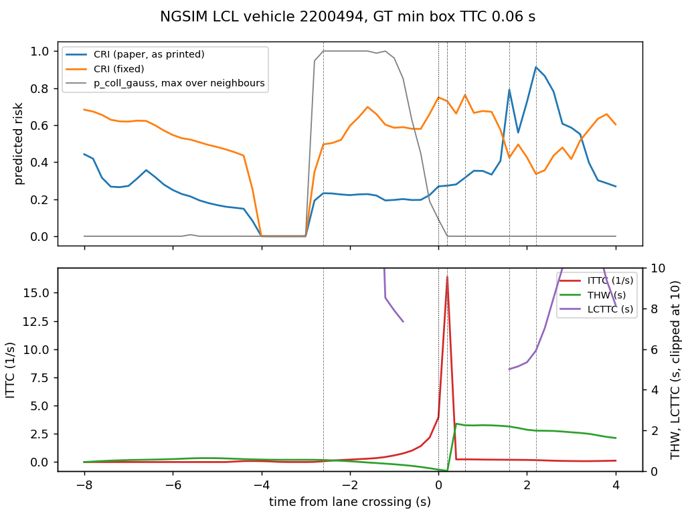

# STGAT-EDGRU and the Collision Risk Index on NGSIM

This is a reproduction of Su, Wang & Wang, *Collision Risk Assessment of Lane-Changing Vehicles
Based on Spatio-Temporal Feature Fusion Trajectory Prediction* (Electronics 2025, 14, 3388).
The paper trains on HighD; this study runs it on NGSIM, in two ways:

- **R, the repo pipeline.** The model goes through the same data, split, budget and risk scoring
  as the 38 other models in [EXPERIMENTS_OVERVIEW.md](EXPERIMENTS_OVERVIEW.md). It is then tuned
  like the seven models in [RISK_TUNING_RESULTS.md](RISK_TUNING_RESULTS.md) and added to the risk
  timeline of [RISK_TIMELINE.md](RISK_TIMELINE.md). Its numbers are directly comparable with
  every other model in the repo.
- **P, the paper-faithful pipeline** (`experiments/stgat_paper.py`). This follows the paper's
  setup as closely as NGSIM allows:
  - 5 Hz, 3 s of history and 5 s of future;
  - six features (x, y, vx, vy, ax, ay);
  - samples centred on lane changes and balanced against lane keeping;
  - every vehicle in the scene predicted;
  - teacher forcing, 120 epochs, batch 64, Adam 2e-4;
  - ablations M1–M3, and the paper's own risk measure, the CRI.

  P's numbers are comparable with the paper's tables only in kind, not in value (different
  dataset).

The Collision Risk Index (CRI) is implemented twice:
- **`cri_paper`** is exactly as printed.
- **`cri_fixed`** repairs the two equations that are wrong (§1.2).

---

## Summary

- **Trajectory accuracy, repo pipeline (R).**
  - Test RMSE is **2.147 m** averaged over 1–5 s, and 4.247 m at 5 s.
  - That ranks **22nd of the 47 entries** in `comparison_rmse.csv` (39 baselines, 7 tuned,
    constant velocity): mid-table, between fhif (2.145) and ts_gan (2.148).
  - At 1 s it is the second-best untuned model (0.448 m, after traj_mamba's 0.445), but its
    error grows fastest: at 5 s it is behind every model of similar average.
  - It has 714 k parameters, 3–5× the models around it.
- **Trajectory accuracy, paper pipeline (P).**
  - Main vehicle: average RMSE **2.75 m**, 5.41 m at 5 s. Constant velocity scores 3.73 m and
    7.21 m.
  - The paper reports 1.12 m at 5 s on HighD. NGSIM is noisier, more congested and has longer
    lane changes, so the gap is expected; the method still beats constant velocity by 26 %.
- **The ablations do not reproduce.**
  - Main-vehicle average RMSE is 2.75 (full), 2.75 (M1, no Transformer), 2.79 (M2, uniform
    attention) and 2.74 (M3, no GMU).
  - All four are within 0.05 m of each other. Only M2 is consistently worse, and only by 1–2 %.
  - The paper's Table 3 shows M2 far worse than every other variant; here it is barely
    distinguishable.
- **The predicted uncertainty is badly overconfident.**
  - At 5 s the model predicts σ ≈ 0.23 m longitudinally and 0.06 m laterally, while the actual
    error is 5.4 m.
  - Only **0.6 %** of true positions fall inside the 95 % ellipse at 5 s, and 75 % at 1 s.
  - The cause is teacher forcing: during training the decoder always sees the true previous
    position, so it never learns how errors compound.
  - Any probability built on this σ, including the CRI's collision probability, is close to
    a hard distance threshold on the predicted mean.
- **The CRI ranks risk worse than the predicted minimum distance.**
  - On P's test set (636 samples, 9,327 pairs), plain `min_dist` on the predicted trajectories
    beats both CRIs on every label at both pair and sample level.
  - At pair level the CRI beats `p_coll_gauss`/`p_coll_mc` on distance labels (ROC-AUC 0.96
    vs 0.83 at < 2 m). It does so only because, with near-zero σ, it is effectively a
    thresholded predicted distance.
  - Its PR-AUC is much lower (0.02–0.03 vs 0.34), so its top-ranked pairs are mostly false
    alarms.
  - `cri_fixed` ≥ `cri_paper` at sample level on every label (e.g. 0.80 vs 0.68 at < 2 m).
  - The paper's multi-vehicle aggregation does not help (§4.2).
- **The "CRI warns 0.4–0.6 s earlier" claim is not supported.**
  - Over the 10 test-split lane changes with the lowest ground-truth TTC, the CRI peak comes
    before the ITTC peak in 7 of 10 cases for both versions.
  - The leads are spread from −3 s to +9 s, which is noise rather than a consistent lead.
  - The repo's own `p_coll_gauss`, computed from the same predictions, peaks before ITTC in
    **10 of 10** cases (median lead 1.5 s).
- **In the repo pipeline, the model ranks 15th of 16 under `pred`.**
  - Measures use the model's own neighbour predictions. Mean headline ROC-AUC at < 2 m is
    0.734 [0.684, 0.789]; only x_track_tuned is lower (0.723). The 15 others range 0.723–0.914.
  - With constant-velocity neighbours (`cv`, `cv_scene`) it sits in the middle, as every model
    does there (0.946 and 0.928, spreads of 0.01).
  - So its target paths are as good for risk as anyone's; when it predicts both sides of a
    pair, it ranks pairs poorly.
- **In the repo pipeline the CRI is the worst probability-style measure.**
  - Even on the true future (`oracle`) its PR-AUC at < 2 m is **0.005**, against 0.35–0.79 for
    the headline measures.
  - The Eq. 30 circle (≈ 4.5–5 m for two cars) is far larger than a 2 m near-collision. In
    congested traffic, many safe followers stay inside it for the whole horizon and outrank
    the real near-collisions.
- **Tuning (R):** see §6.

---

## 1. The paper, and what had to be decided

### 1.1 The model

STGAT-EDGRU has five stages:
1. **Embedding.** Each vehicle's history is embedded per step (Linear 6 → 128) and passed
   through a 2-layer Transformer encoder over time, giving the temporal feature.
2. **Spatial attention.** At every history step, multi-head graph attention runs over the
   vehicles within **50 m**, then residual, LayerNorm and an MLP, giving the spatial feature.
3. **Fusion.** A gated multimodal unit (GMU) fuses the two:
   `z = σ(W[fs, fr])`, `f = z·fs + (1 − z)·fr` (Eqs. 19–22).
4. **Encoding.** A GRU encoder runs over the fused sequence.
5. **Decoding.** An autoregressive GRU decoder emits one bivariate Gaussian
   (μx, μy, σx, σy, ρ) per future step for every vehicle.

The code is in `src/models/stgat_edgru.py`; the ablation flags `use_transformer`,
`use_attention` and `use_gmu` give the paper's M1, M2 and M3.

Choices the paper leaves open or contradicts:

| # | Paper | Here | Why |
|---|---|---|---|
| D1 | The GAT input is "the fused feature f_j", but fusion happens after the GAT. | The GAT takes the per-step input embedding. | The circular definition has no other reading. |
| D2 | Eq. 22 weights fs by z; Algorithm 1 weights it by 1 − z and adds instead of concatenating. | Eq. 22. Gate bias initialised to 0, so z starts at 0.5. | The equations are explicit; the algorithm box looks like a transcription slip. |
| D3 | The decoder feeds back the previous position and emits a position distribution. | The FC head emits the step increment, μ_t = μ_{t−1} + Δ, and the GRU sees μ_{t−1}/10 m. | Feeding raw positions (up to ~75 m) saturated the GRU: a debug run's 5 s RMSE was 28 m, three times worse than constant velocity. With increments it was 5.5 m. |
| D4 | Model selection is not stated. | P selects the epoch with the lowest **validation RMSE of the main vehicle**. | With teacher forcing, validation NLL rises from epoch 1 on (§3.3), so selecting on NLL would keep an untrained model. |
| D5 | Ablation M3 feeds the observation-time features straight to the decoder. | M3 concatenates the temporal and spatial sequences and keeps the GRU encoder. | Isolates the GMU itself rather than the GMU plus the encoder. |

### 1.2 The Collision Risk Index

For each future step t and each neighbour j:
- **P_t** is the probability that the relative position falls inside a circle whose radius
  comes from both vehicles' sizes (Eq. 30), computed by Monte Carlo over the relative Gaussian.
- **E_t** is a collision intensity from the speed difference.
- **F_t = P_t · E_t**.
- Neighbours are combined by `w_j = P_j / Σ P` (Eqs. 33–34), and horizons by
  `CRI = α1 · mean_t F + α2 · max_t F` (Eq. 35).

Three of these equations cannot be used as printed:

| Eq. | As printed | Problem | `cri_fixed` |
|---|---|---|---|
| 29 | Relative σ = σ_i + σ_j, ρ = ρ_i + ρ_j | For independent Gaussians the *variances* (covariance matrices) add. Adding correlations can give \|ρ\| > 1. | Σ = Σ_i + Σ_j |
| 32 | E = exp(−arctan \|Δ\|v\|\|) | Equals 1 at equal speeds and *falls* to 0.21 as the speed difference grows, so a harder impact counts as gentler. It also uses the difference of speeds, not of velocity vectors. | E = (2/π) · arctan ‖Δv‖ (0 at equal velocity, rising to 1) |
| 35 | F_mean does not contain F; α, α1, α2, M and the time weights are never given. | Not reproducible. | Both versions: α1 = α2 = 0.5, uniform time weights, M = 1000 draws with a fixed seed (`CRI_*` constants in `risk_metrics.py`). |

Both versions are registered as pairwise measures in `src/evaluation/risk_metrics.METRICS`
(`cri_paper`, `cri_fixed`) and are scored next to the repo's 30 risk measures. They are not
in `HEADLINE_METRICS`, so the existing reports' headline numbers are unchanged.

In R the neighbours are deterministic (constant-velocity or predicted means, no σ), so σ_j = 0
and the two versions differ only in E. In P every vehicle has its own predicted Gaussian, so
both equations take effect.

---

## 2. The two pipelines

| | R: repo pipeline | P: paper-faithful |
|---|---|---|
| Data | NGSIM US-101 + I-80, every vehicle with ≥ 8 s of track | Same recordings, lane-change-centred windows |
| Rate, history / future | 10 Hz, 3 s / 5 s (30 / 50 steps) | 5 Hz, 3 s / 5 s (15 / 25 steps) |
| Features | The repo's 11 (target history always (0, 0), S5) | x, y, vx, vy, ax, ay from 1 s-smoothed positions, in a frame fixed at the main vehicle's first history position |
| Neighbours | Up to 15, risk-selected | Up to 15 present for the whole 8 s and within 50 m at t_start |
| Predicted | Target only | Every vehicle |
| Samples | 540 k train / 121 k test | 6,420 (5,114 / 670 / 636) |
| Split | Per recording, temporal 70/10/20 | 8:1:1 grouped by vehicle, seed 42 |
| Training | 12 epochs, lr 5e-4 × 0.6/epoch, batch 128, free-running decoder; then Optuna | 120 epochs, Adam 2e-4, batch 64, teacher forcing |
| Selection | Lowest validation loss | Lowest validation RMSE (main vehicle) |

**P's samples.**
- A lane change is a change of `lane_id`: up is a right change (LCR), down is a left change
  (LCL). Ramp lanes ≥ 7 are skipped.
- The execution start t_start is the last frame with |vy| < 0.2 m/s within 5 s before the
  crossing. The paper defers this to its ref. [44], which was not available.
- 4,044 lane changes qualified, giving 2,569 LCL and 951 LCR samples once each had a full 8 s
  window. They were balanced by 2,900 lane-keeping windows (count = max(#LCL, #LCR)).
- Test split: 314 LK, 240 LCL, 82 LCR.

---

## 3. Trajectory accuracy

### 3.1 R: against the other 46 entries

Test split, 121,130 samples, RMSE in metres.

| model | 1 s | 2 s | 3 s | 4 s | 5 s | avg | params |
|---|---|---|---|---|---|---|---|
| miat (best untuned) | 0.449 | 1.101 | 1.887 | 2.866 | 4.055 | 2.072 | 195 k |
| fhif | 0.478 | 1.148 | 1.958 | 2.962 | 4.181 | 2.145 | 171 k |
| **stgat_edgru** | **0.448** | 1.116 | 1.943 | 2.979 | 4.247 | **2.147** | 714 k |
| ts_gan | 0.486 | 1.156 | 1.960 | 2.965 | 4.174 | 2.148 | 238 k |
| cs_lstm | 0.474 | 1.164 | 2.027 | 3.130 | 4.502 | 2.259 | 192 k |
| cv | 0.602 | 1.588 | 2.878 | 4.470 | 6.326 | 3.173 | 0 |

- Short-horizon error is among the best (0.448 m at 1 s; only traj_mamba is lower among the
  untuned models), but the error grows faster than in the attention models of similar average. At 5 s it is 4.25 m, against
  4.05–4.14 m for miat, x_track, stdan and cognitive.
- Per site: US-101 2.151, I-80 2.140. Samples with zero neighbours: 2.496 (the 50 m GAT has
  nothing to attend to, so this is the Transformer + GRU path alone).
- The validation RMSE falls almost every epoch to the end (2.51 → 2.08 m, best at epoch 12 of
  12), so the default schedule stops it early. §6 tunes it.

### 3.2 P: main vehicle and all vehicles

Test split, 636 samples (9,963 vehicles). RMSE in metres.

| | 1 s | 2 s | 3 s | 4 s | 5 s | avg | ADE | FDE | NLL |
|---|---|---|---|---|---|---|---|---|---|
| **main vehicle**, STGAT-EDGRU | 0.38 | 1.50 | 2.57 | 3.88 | 5.41 | 2.75 | 1.65 | 4.14 | 147 |
| main vehicle, constant velocity | 0.61 | 2.07 | 3.52 | 5.24 | 7.21 | 3.73 | 2.36 | 5.59 | 9.2¹ |
| **all vehicles**, STGAT-EDGRU | 0.25 | 0.97 | 1.95 | 3.17 | 4.62 | 2.19 | 1.35 | 3.54 | 110 |
| all vehicles, constant velocity | 0.48 | 1.52 | 2.85 | 4.47 | 6.37 | 3.14 | 1.93 | 4.84 | 7.1¹ |
| *paper, main vehicle (HighD)* | *0.14* | *0.21* | *0.33* | *0.61* | *1.12* | | | | |

¹ Constant velocity with σ = 1 m fixed at every step, for scale only.

By manoeuvre (main vehicle, average RMSE): LK 2.20, LCL 2.72, **LCR 4.22**. Constant velocity
scores 2.95 / 4.03 / 5.16. Right lane changes are the hardest, and the rarest (15 % of the
training samples).

- **All vehicles are easier than the main vehicle**, the reverse of the paper's §5.2.4 (which
  reports higher error for all vehicles). Here the main vehicle is usually the one changing
  lanes, while most neighbours keep their lane.
- **NLL is 16× worse than constant velocity with a fixed 1 m σ.** The model's σ is far too
  small (§3.4), so every large error is heavily penalised.

### 3.3 Ablations (P, Table 3 analogue)

Main-vehicle RMSE in metres; best validation RMSE in brackets.

| variant | 1 s | 2 s | 3 s | 4 s | 5 s | avg | all-vehicle avg | train min |
|---|---|---|---|---|---|---|---|---|
| full | 0.38 | 1.50 | 2.57 | 3.88 | 5.41 | 2.747 (2.655) | 2.193 | 5.9 |
| M1 no Transformer | 0.36 | 1.46 | 2.56 | 3.88 | 5.46 | 2.746 (2.678) | 2.183 | 4.2 |
| M2 uniform attention | 0.39 | 1.51 | 2.58 | 3.92 | 5.54 | 2.787 (2.679) | 2.246 | 8.8 |
| M3 concat, no GMU | 0.37 | 1.50 | 2.56 | 3.86 | 5.43 | 2.743 (2.702) | 2.212 | 12.7 |

- The full model is best on validation, but on test the four variants are within 0.05 m. With
  636 test samples, differences this small are noise.
- M2 is the only variant that is worse at every horizon, all-vehicle included, and only by
  1–3 %. The paper's large M2 gap (worse than S-LSTM) does not appear.
- Teacher forcing makes the validation NLL rise from epoch 1 in every variant (full: 38 at
  epoch 1, 109 at the selected epoch 57, 649 at epoch 120). Validation RMSE bottoms out at
  epochs 57–85 and drifts up again (full: 2.65 → 2.99 m by epoch 120). Selecting on NLL (D4)
  would have kept epoch 1, whose validation RMSE is 9.0 m.

### 3.4 Calibration (P)

Mean predicted σ and the share of true positions inside the predicted 95 % ellipse, main
vehicle, test split.

| horizon | 1 s | 2 s | 3 s | 4 s | 5 s |
|---|---|---|---|---|---|
| σx (m) | 0.15 | 0.19 | 0.20 | 0.21 | 0.23 |
| σy (m) | 0.048 | 0.069 | 0.061 | 0.056 | 0.056 |
| RMSE (m) | 0.38 | 1.50 | 2.57 | 3.88 | 5.41 |
| **95 % coverage** | 75 % | 18 % | 4.1 % | 1.4 % | **0.6 %** |

The ablations are no better (5 s coverage 0.5–0.8 %).
- During training the decoder is fed the true previous position, so its NLL only ever measures
  the one-step error, which is small. At test time it feeds back its own predictions, and the
  errors compound unseen.
- R's decoder is trained free-running, on its own rollouts, so this mechanism does not apply
  there.
- For the risk measures this means P's collision probabilities are nearly 0 or 1: a step function
  of the predicted mean distance.

---

## 4. Risk ranking in the paper-faithful pipeline

Test split, 636 samples:
- **pair level:** every (main vehicle, neighbour) pair, 9,327 pairs;
- **sample level:** each score's maximum over the neighbours (minimum for distance), against
  "any neighbour positive".

Labels come from the **ground-truth** future: minimum centre distance < 2 / 3 / 5 m, or minimum
box TTC < 1.5 / 3 s. Every measure is computed from P's predicted trajectories; the CRIs use both
vehicles' Gaussians, and the other measures use the main vehicle's σ only. 95 % CIs resample
whole vehicle-pair events.

Positives (pair / sample): < 2 m 12 / 12, < 3 m 65 / 52, < 5 m 791 / 465, TTC < 1.5 s 84 / 64,
TTC < 3 s 274 / 189. **At < 2 m there are only 12 positives**, so those CIs are wide (about ±0.12).

### 4.1 ROC-AUC

| measure | pair < 2 m | pair < 3 m | pair TTC < 1.5 s | sample < 2 m | sample < 3 m | sample TTC < 1.5 s | sample TTC < 3 s |
|---|---|---|---|---|---|---|---|
| `min_dist` | **0.981** | **0.962** | **0.881** | **0.869** | **0.845** | 0.759 | 0.623 |
| `cri_paper` | 0.962 | 0.928 | 0.835 | 0.677 | 0.683 | 0.659 | 0.603 |
| `cri_fixed` | 0.962 | 0.937 | 0.836 | 0.803 | 0.778 | 0.707 | 0.617 |
| `cri_paper` multi-vehicle | | | | 0.679 | 0.677 | 0.657 | 0.601 |
| `cri_fixed` multi-vehicle | | | | 0.754 | 0.748 | 0.681 | 0.613 |
| `p_coll_gauss` | 0.828 | 0.678 | 0.762 | 0.849 | 0.666 | **0.794** | 0.670 |
| `p_coll_mc` | 0.828 | 0.672 | 0.728 | 0.818 | 0.646 | 0.767 | 0.652 |
| `ttc_true` | 0.838 | 0.597 | 0.690 | 0.832 | 0.647 | 0.722 | **0.701** |
| `tet` | 0.706 | 0.567 | 0.606 | 0.726 | 0.594 | 0.642 | 0.568 |

### 4.2 PR-AUC

| measure | pair < 2 m | pair < 3 m | pair TTC < 1.5 s | sample < 2 m | sample TTC < 1.5 s |
|---|---|---|---|---|---|
| `min_dist` | 0.105 | 0.248 | 0.205 | 0.145 | 0.366 |
| `cri_paper` | 0.028 | 0.079 | 0.080 | 0.039 | 0.158 |
| `cri_fixed` | 0.018 | 0.119 | 0.126 | 0.054 | 0.226 |
| `p_coll_gauss` | 0.341 | 0.202 | 0.354 | 0.364 | 0.506 |
| `p_coll_mc` | **0.375** | **0.252** | **0.380** | **0.435** | **0.529** |

ROC curves: `experiments/results/stgat_paper/roc_window_*.png`.

**Reading the tables:**
- **Predicted distance is the best ranker.** No probability-style measure beats the plain
  minimum predicted distance on ROC-AUC, at either level. Everything the CRI adds (Gaussian
  overlap, intensity, horizon fusion, multi-vehicle weights) costs ranking accuracy.
- **The CRI's high pair-level ROC-AUC is the overconfident σ at work.** With σ ≈ 0.2 m, P_t is
  1 when the predicted centres are closer than the collision radius (Eq. 30 gives ≈ 4.5–5 m for
  two cars) and 0 otherwise. So the CRI is "fraction of horizon steps with predicted distance below 2.5 m,
  times an intensity", a coarse version of `min_dist`. It sorts most safe pairs to zero (high
  ROC-AUC) but ties and misorders the closest ones (low PR-AUC).
- **`p_coll_gauss`/`p_coll_mc` have the best precision** on rare events. They look at the
  *closest* step only, and their top scores are the real near-collisions.
- **`cri_fixed` beats `cri_paper` at sample level on every label** (+0.13 at < 2 m, +0.05 at
  TTC < 1.5 s). Adding σ's rather than variances inflates the relative spread, and the
  backwards intensity favours slow, harmless pairs.
- **The paper's multi-vehicle aggregation does not help.** For `cri_paper` it is within ±0.01
  of the single-neighbour maximum on every label. For `cri_fixed` it is 0.02–0.05 lower on
  every label except < 5 m (+0.008).
- **Brier scores** (pair level, < 2 m): `p_coll_gauss` 0.0099, `p_coll_mc` 0.0101. The CRI is
  not a probability of any event the labels define, so it has none.

---

## 5. Risk ranking in the repo pipeline

Same protocol as [RISK_TUNING_RESULTS.md](RISK_TUNING_RESULTS.md) §5:
- `cv`/`oracle`: 1,814,838 pairs and 977 positives at < 2 m;
- `cv_scene`/`pred`: 440,276 pairs and 912 positives;
- CIs resample about 100 independent vehicle-pair events.

Sources:
- `cv`: the model's target path, every neighbour at constant velocity;
- `cv_scene`: the same, on the `pred` pair set;
- `pred`: the model's own neighbour predictions;
- `oracle`: the true future, model-free.

### 5.1 Against the 15 tuned-study entries

Mean headline ROC-AUC (`p_coll_gauss`, `p_coll_mc`, `s_field_cal`, `min_dist`, `ttc_true`,
`tet`), label < 2 m.

| source | stgat_edgru | rank of 16 | the other 15 |
|---|---|---|---|
| `cv` | 0.946 | 6 | 0.939–0.948 |
| `cv_scene` | 0.928 | 8 | 0.922–0.931 |
| `pred` | **0.734** [0.684, 0.789] | **15** | 0.723–0.914 (median 0.81) |

At < 3 m under `pred` it is again 15th of 16 (0.646; x_track_tuned 0.641).

- **Under `cv` and `cv_scene` every model scores the same**, as in the tuned study §5.2: the
  target's own path does not decide risk accuracy, the neighbours do.
- **Under `pred` it is near the bottom.** There, each neighbour is run through the model as its
  own target, so the score depends on the model's predicted velocities and σ for every
  vehicle in the pair. Validation RMSE does not constrain those. Its RMSE (2.147) is
  ordinary, so this is the same RMSE-vs-risk gap that the tuned study finds (§6 there):
  x_track_tuned has the best RMSE and the worst `pred` risk.

### 5.2 Per measure, label < 2 m

ROC-AUC / PR-AUC.

| measure | `oracle` | `cv` | `cv_scene` | `pred` | `pred`, inatran (best) |
|---|---|---|---|---|---|
| `p_coll_gauss` | 0.771 / 0.348 | 0.962 / 0.193 | 0.920 / 0.206 | 0.770 / 0.175 | 0.938 |
| `p_coll_mc` | 0.771 / 0.348 | 0.936 / 0.273 | 0.905 / 0.292 | 0.747 / 0.198 | 0.921 |
| `s_field_cal` | 0.998 / 0.382 | 0.982 / 0.272 | 0.953 / 0.301 | 0.777 / 0.193 | 0.933 |
| `min_dist` | 1.000 / 0.543 | 0.972 / 0.068 | 0.949 / 0.070 | 0.708 / 0.020 | 0.910 |
| `ttc_true` | 0.998 / 0.564 | 0.944 / 0.594 | 0.948 / 0.621 | 0.714 / 0.291 | 0.943 |
| `tet` | 1.000 / 0.788 | 0.879 / 0.232 | 0.893 / 0.245 | 0.687 / 0.034 | 0.836 |
| **`cri_paper`** | 0.935 / **0.005** | 0.917 / 0.004 | 0.777 / 0.005 | 0.592 / 0.002 | |
| **`cri_fixed`** | 0.951 / **0.005** | 0.931 / 0.004 | 0.830 / 0.006 | 0.655 / 0.004 | |

At < 3 m the CRI does better relative to the others: `oracle` 0.950 / 0.966 ROC-AUC, PR-AUC
0.053 / 0.078. Under `pred`, `cri_fixed` (0.746) is second only to `s_field_cal` (0.843) and
`min_dist` (0.794).

- **The CRI's precision is near zero even with a perfect future.** The base rate at < 2 m is
  0.05 % (`cv`) / 0.2 % (`pred`), and the CRI's PR-AUC barely exceeds it.
  - The Eq. 30 circle has a radius of half the diagonal of the summed boxes, ≈ 4.5–5 m for two
    cars. Any pair whose centres stay within that distance gets P ≈ 1 for the whole horizon.
  - NGSIM is congested: many same-lane followers sit 4–6 m centre-to-centre for seconds.
  - Those pairs saturate the CRI ahead of the brief true near-collisions. `p_coll_gauss` uses
    a car-sized box instead of the circle and keeps its precision.
- **`cri_fixed` ≥ `cri_paper` everywhere**, by 0.01–0.07, as in P. In R the neighbour has no σ,
  so the difference is the intensity term alone: the paper's version gives its highest
  weight to pairs moving at the *same* speed, which is exactly the safe-follower case above.
- **No new information over `min_dist`.** On `oracle`, `min_dist` is a perfect ranker by
  construction. The CRI, built from the same distances, loses most of that because of the
  circle and the intensity weighting.

Calibration (Brier, `p_coll_gauss`, < 2 m): 0.0059 (`cv`) and 0.0219 (`cv_scene`), the
same as every other model. Under `pred` it is 0.0185, level with x_track and x_track_tuned
(0.019) and far behind the risk leaders inatran (0.0068) and cognitive (0.0079).

---

## 6. Tuning (R)

*Filled in when the Optuna study finishes.*

---

## 7. The paper-style lane-change case (Fig. 6 analogue)

The paper shows one HighD vehicle (Vid986, a right lane change with min TTC < 1 s) whose CRI
peaks 0.4–0.6 s before ITTC, LCTTC and THW. Here the same plot is drawn for the **ten test-split
lane changes with the lowest ground-truth box TTC** that pass plausibility checks (no box
overlap anywhere in the 8 s window, |ax| ≤ 8 m/s² for the main vehicle).

**Method.**
- P's model is run on 15-frame sliding windows at 0.2 s stride, from 8 s before to 4 s after
  the lane crossing. Each window gives the multi-vehicle `cri_paper` and `cri_fixed`, and the
  maximum `p_coll_gauss` over the neighbours.
- The ground-truth surrogates are computed at each window's last observed frame:
  - **ITTC:** inverse TTC to the in-path leader, in 1/s;
  - **THW:** time headway to the in-path leader, in seconds (the paper plots it in metres);
  - **LCTTC:** a 2D box constant-velocity TTC against vehicles in the target lane. The paper's
    ref. [49] was not available.
- A "lead" is the time from a risk measure's peak to the surrogate's peak (ITTC maximum, THW and
  LCTTC minimum). Positive means the risk measure peaked first.



The most critical case: vehicle 2200494, a left lane change, GT min TTC 0.06 s.
- `cri_paper` peaks at +2.2 s (0.91), after ITTC (+0.2 s).
- `cri_fixed` peaks at +0.6 s.
- `p_coll_gauss` saturates at 1.0 from −2.6 s to −1 s, then falls to zero after the
  crossing.
- All three measures drop to zero between −4 s and −3 s although 15 neighbours are in range:
  the predicted paths keep every neighbour outside the collision circle, and with σ ≈ 0.2 m no
  probability is left in the tails.

**Leads over the ten cases** (seconds; positive = risk peaks first):

| case (vid, kind, GT min TTC) | `cri_paper` vs ITTC | `cri_fixed` vs ITTC | `p_coll_gauss` vs ITTC | `cri_paper` vs LCTTC | `cri_fixed` vs LCTTC | `p_coll_gauss` vs LCTTC |
|---|---|---|---|---|---|---|
| 2200494 LCL 0.06 s | −2.0 | −0.4 | +2.8 | −0.6 | +1.0 | +4.2 |
| 2300800 LCL 0.08 s | −3.0 | +6.2 | +7.8 | −3.6 | +5.6 | +7.2 |
| 2101278 LCL 0.22 s | +7.0 | +7.0 | +0.6 | +0.4 | +0.4 | −6.0 |
| 2101628 LCR 0.36 s | +9.0 | +0.4 | +1.6 | −1.4 | −10.0 | −8.8 |
| 2200706 LCR 0.38 s | +4.4 | +6.8 | +0.6 | +1.6 | +4.0 | −2.2 |
| 2200706 LCL 0.38 s | +4.4 | +6.8 | +0.6 | +5.2 | +7.6 | +1.4 |
| 1100586 LCR 0.56 s | −1.4 | −1.8 | +1.4 | +0.2 | −0.2 | +3.0 |
| 1200037 LCL 0.57 s | +4.2 | +0.8 | +1.0 | +4.6 | +1.2 | +1.4 |
| 2301077 LCL 0.77 s | +1.6 | +0.6 | +2.4 | −0.4 | −1.4 | +0.4 |
| 2302007 LCL 0.78 s | +1.8 | −3.2 | +2.6 | +0.4 | −4.6 | +1.2 |
| **earlier in** | 7 / 10 | 7 / 10 | **10 / 10** | 6 / 10 | 6 / 10 | 7 / 10 |
| **median lead** | +3.0 | +0.7 | +1.5 | +0.3 | +0.7 | +1.3 |

(THW leads follow ITTC closely: 6, 6 and 8 of 10.)

- **The CRI leads are not a consistent effect.** They span −3 to +9 s, and in three cases a CRI
  peaks 5.2–7.8 s before the crossing, near the start of the plotted span, long before anything
  happens.
- **`p_coll_gauss` on the same predictions leads ITTC in every case** (+0.6 to +7.8 s). This
  is the comparison the paper should have made: any measure that looks 5 s ahead will peak
  before ITTC, which only sees the current frame.
- The lead of a forward-looking measure over a current-frame surrogate is mostly a property of
  the horizon, not of the CRI. The paper's single scene cannot separate the two.

Per-case figures: `experiments/results/stgat_paper/risk_timeline_paper_case_<index>.png`. The
candidate list is in `cases.json`, the scores in `case_scores_<index>.csv`, and the leads in
`case_leads.csv`.

---

## 8. Caveats

- **NGSIM, not HighD.** P copies the paper's protocol, not its data. NGSIM tracks are noisier
  (positions are smoothed over 1 s here), traffic is congested, and lane IDs flicker near lane
  lines. Absolute RMSEs are not comparable with the paper's.
- **The lane-change start rule is a guess** (|vy| < 0.2 m/s, ≤ 5 s back). A different rule
  changes which 3 s of history the model sees.
- **P is small.** 636 test samples and 12 pair positives at < 2 m; most ROC-AUC differences at
  < 2 m are inside each other's CIs. The < 3 m, < 5 m and TTC labels have 52–791 positives.
- **The ten case-study vehicles were chosen by ground-truth TTC**, and some of those low TTCs are
  NGSIM artefacts (boxes touching at 0.06 s TTC with no collision). The leads are a
  distribution over ten cases, not a general estimate.
- **CRI constants** (α1 = α2 = 0.5, uniform time weights, M = 1000) are this study's choices;
  the paper does not give them.
- **One seed per configuration.** The ablation differences (≤ 0.05 m) are below what a second
  seed would likely move.

---

## 9. Reproducing

```bash
# GPU box: tests, then the repo pipeline (R)
python -m pytest tests/test_stgat_edgru.py -q
python experiments/run_all.py --full stgat_edgru
python experiments/tune_top.py stgat_edgru
python experiments/score_risk.py stgat_edgru stgat_edgru_tuned \
    --sources cv,oracle,cv_scene,pred --out experiments/results/risk_v2

# GPU box: the paper-faithful pipeline (P); training is 32 min for all four variants
bash experiments/stgat_paper_all.sh      # prepare, train full m1 m2 m3, eval, risk, case

# GPU box: rescore the risk-timeline cases with the CRI columns
python experiments/plot_risk_timeline.py --score

# local, after pulling results/ (never upload results to the box)
python experiments/plot_risk_timeline.py --plot --metric cri_fixed
python experiments/risk_timeline_figures.py
```

Files: `src/models/stgat_edgru.py`, `experiments/stgat_edgru.ipynb`,
`experiments/stgat_paper.py`, `experiments/stgat_paper_all.sh`, the CRI functions in
`src/evaluation/risk_metrics.py`, `tests/test_stgat_edgru.py`, and results in
`experiments/results/stgat_edgru*.json`, `experiments/results/stgat_paper/` and
`experiments/results/risk_v2/stgat_edgru*`.
